# Play with data

## 摘要

这是最近在玩的一个项目，用 Vibe Coding 整了一个个人数据工作台，主要是把Power BI以及Alteryx的部分功能搬了进来。我的上一篇提到，Power BI里的数据建模功能没有做，因为我想用Alteryx的部分功能去替代。这一篇就来看一下用国产智能体和大模型目前搞出来的样子。

接下来上图，首先是系统主界面：

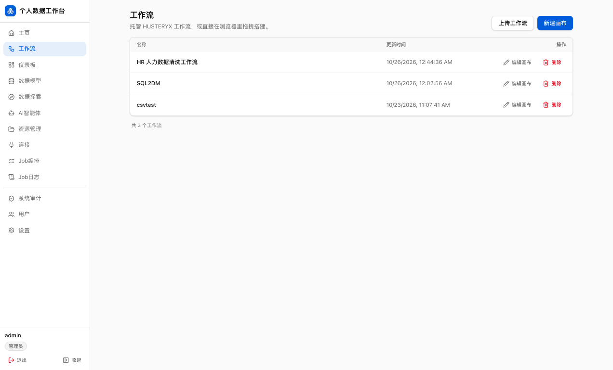

## 记在前面

和上一篇一样，我是在 Mac 上玩的。整个东西是 Vibe Coding 出来的：Trae + 火山 Agent Plan 里的 DeepSeek V4.1 Flash，一边翻 Alteryx 的界面一边和 AI 描述行为。工作流引擎底层用的是 DuckDB，每个节点执行完就是一张中间表，所以链路能一步步往下走，也能随时回到某一步看数据。

这一篇里的工作流是现搭的一条，数据也是临时造的，全部功能点都在这条链路上用到了：15 个转换类节点、3 个输入（两个 CSV 加一个 Text Input）、5 个输出（数据模型、Excel、CSV 各写一份，再加两个 Browser）。SQL Server 的输入输出和 Excel 输入这次先跳过。

案例数据长这样：

| 文件 | 行数 | 埋的脏数据 |
| --- | --- | --- |
| 总部花名册 employees_hq.csv | 16 | 姓名首尾有空格、部门代码小写 `d01`、城市为空、2 人已离职、办公点写成「武汉-3」 |
| 分公司花名册 employees_branch.csv | 10 | 同样结构，城市换成长沙，2 人已离职，部分城市为空 |
| 部门码表（A 手工录入） | 4 | 部门代码 / 部门名称 / 业务条线 |

## 一、设计器布局

新建之后进设计器，界面分四块：

- 顶部工具栏：工作流名称、**未保存**提示、运行状态徽章（运行成功 / 运行失败）、运行与保存按钮；
- 节点库（Ribbon）：输入 / 转换 / 输出三个页签，节点按用途分组摆放，图标大、名字在下；
- 中央画布：节点拖进来就是一条流水线，连线即端口；
- 左侧配置面板 + 底部结果面板：选中节点后左侧改参数、底部看这一阶段的输出数据。

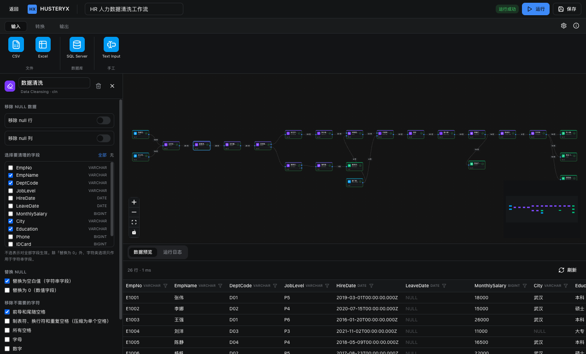

这套布局基本是 Alteryx 的肌肉记忆：左边改参数、下面看数据、中间连。不同的是我把「运行」放在了右上角，可以不保存直接试跑，跑完再决定要不要存。

## 二、从空白画布开始，节点在 Ribbon 里找

新建画布是空的，中间会提示「从左侧节点库拖拽节点到画布」，按「输入 → 转换 → 输出」的顺序搭就行。

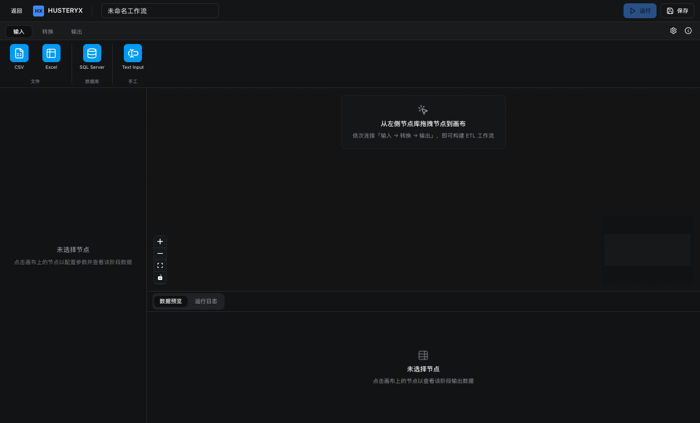

节点库三个页签分别装了这些：

| 页签 | 分组 | 节点 |
| --- | --- | --- |
| 输入 | 文件 / 数据库 / 手工 | CSV、Excel、SQL Server、Text Input |
| 转换 | 选择 / 组合 / 汇总 / 数据准备 / 拆分重组 | Select、Filter、Join、Union、Aggregation、Sort、Running Total、Formula、Find Replace、Unique、Sample、Data Cleansing、Text to Columns、Cross Tab、Transpose |
| 输出 | 数据模型 / 文件 / 数据库 / 浏览 | Data Model、CSV、Excel、SQL Server、Browser |

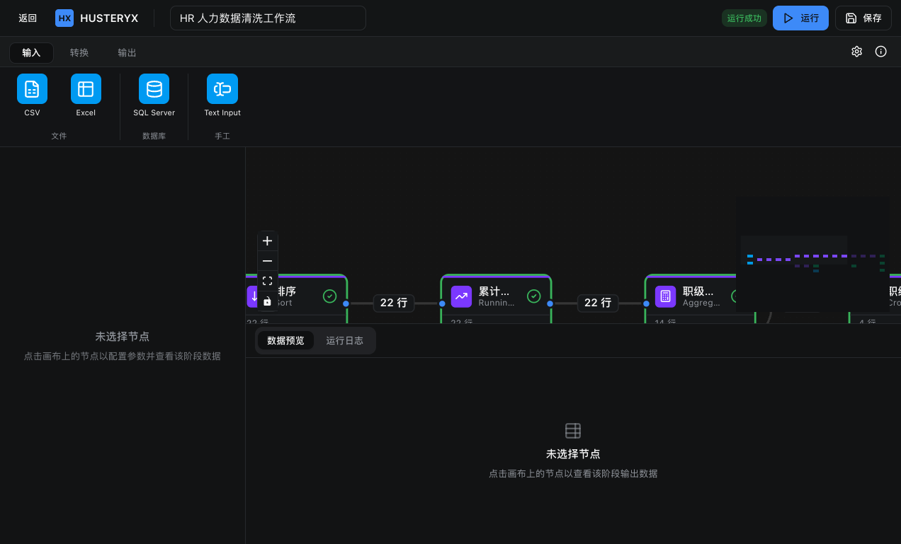

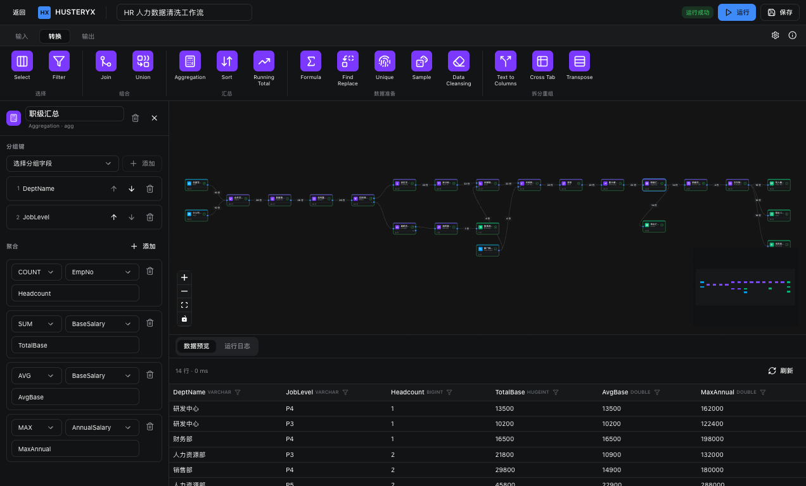

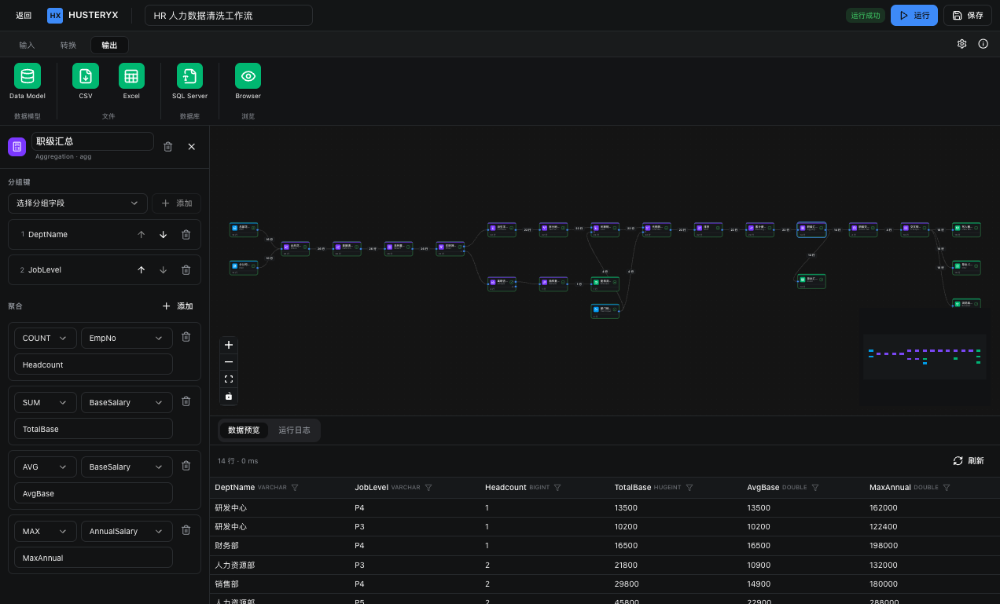

转换页签是主力，15 个节点按用途分了五组。这次要用到全部 15 个，正好可以一次讲完。

## 三、输入：CSV 双源 + 手工码表

画布上一共三个输入：

1. **总部花名册**（CSV）：选文件、选编码 UTF-8、分隔符逗号，「首行为表头」默认打开；路径填相对路径或点文件夹图标上传都行。运行之后，底部预览就能看到这 16 行的真实样子。
2. **分公司表**（CSV）：同结构，改一下路径即可。
3. **部门码表**（Text Input）：手工在界面里敲的四行数据——`D01/研发中心/技术条线`、`D02/销售部/营销条线`、`D03/人力资源部/职能条线`、`D04/财务部/职能条线`。字段类型可以选字符串、整数、浮点、布尔、日期、时间戳，空单元格在数值和日期字段上会转成 NULL。

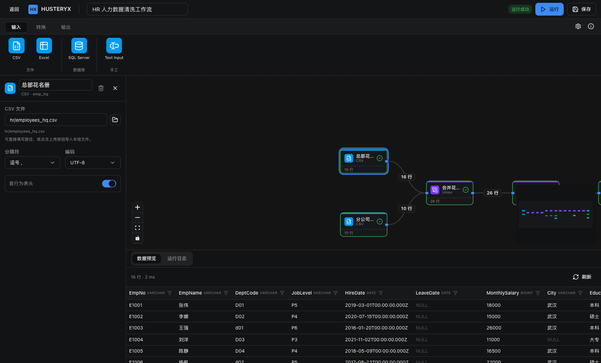

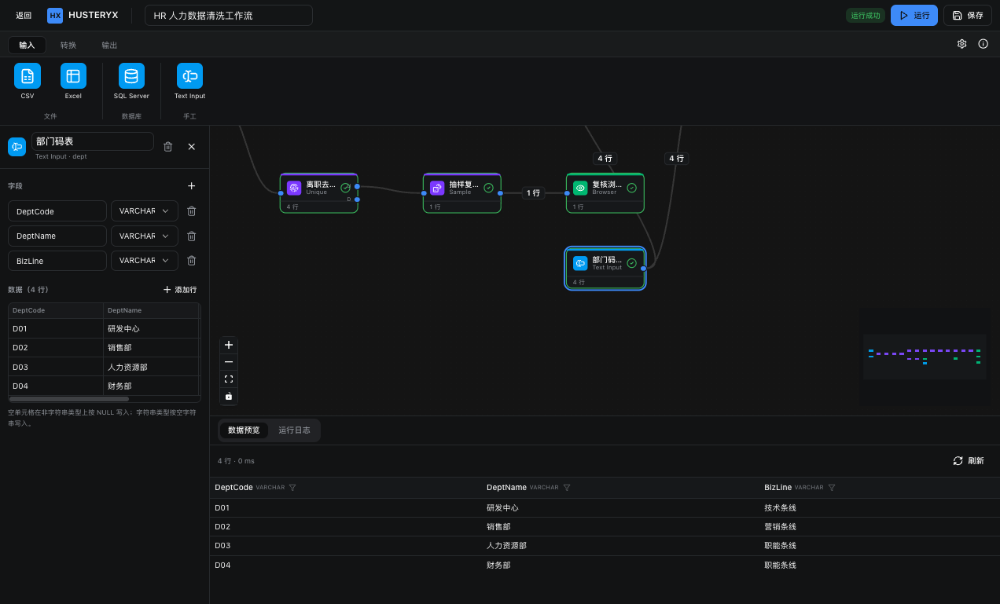

Text Input 在 Alteryx 里是我最常用的节点之一，很多「口径」其实就是一张小码表，能直接敲进去比维护一个 Excel 文件省事。

## 四、数据预览：每一步都能停下来看一眼

底部面板有两个页签：**数据预览**和**运行日志**。选中任意节点，预览区显示的就是这个节点运行后的输出，行数、耗时都在左上角；每列列头带一个漏斗图标，点开是这个列所有去重值的勾选列表，可以边搭边手工过滤看看数据长什么样。

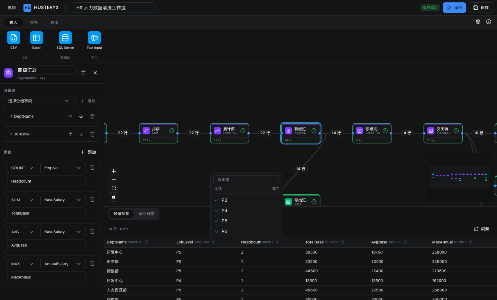

这一步是整条链路里最影响效率的设计。搭工作流最怕的是「跑完发现中间某步是空的」，能随时点开某一步看数据，问题基本一眼就能定位。

## 五、数据清洗与选列

两个来源先合并（Union 放到第九章讲），接下来做标准化。**数据清洗（Data Cleansing）**这个节点处理的是录入脏数据：

- 字段勾选精确到列，这次只处理姓名、部门代码、城市、学历四列，其余列原样通过；
- 「移除 null 行 / 移除 null 列」两个总开关都关着——空城市和离职日期都是有效信息，不能整行整列丢掉；
- 「替换为空白值（字符串字段）」打开——城市为空的行不该被当成异常；
- 「前导和尾随空格」打开——` 王强 ` 这种就干净了；
- 「修改大小写」选「大写」——部门代码 `d01` 和 `D01` 统一成一种写法。

其余「制表符、换行符和重复空格」「所有空格」「字母」「数字」这些选项这次没开，因为花名册里没有这类脏字符。

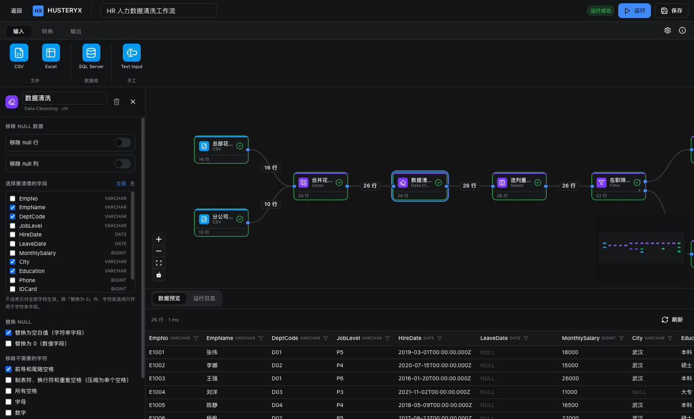

紧接着是**选列重命名（Select）**：12 列里去掉用不上的 `Phone`、`IDCard`，剩下的 10 列顺便改成业务口径——`MonthlySalary` 改名 `BaseSalary`。列的顺序可以上下调整，输出就是最终列序。

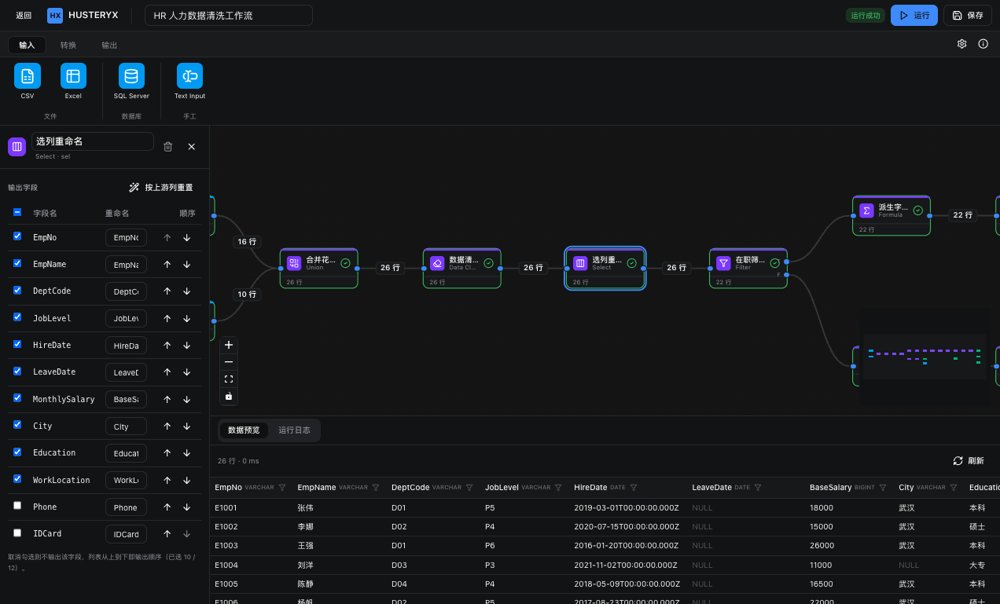

这两步都不改变行数（26 行进、26 行出），属于「整理」而不是「计算」，也是我觉得最该被自动化掉的一类活。

## 六、过滤与公式：只算在职员工，顺便派生指标

**在职筛选（Filter）**用一句表达式搞定：`"LeaveDate" IS NULL`。Filter 有两个输出端口，T 是命中的行，F 是不命中的行——22 行走 T 继续往下，4 个已离职的人从 F 单独引出去，后面用来做离职核对。

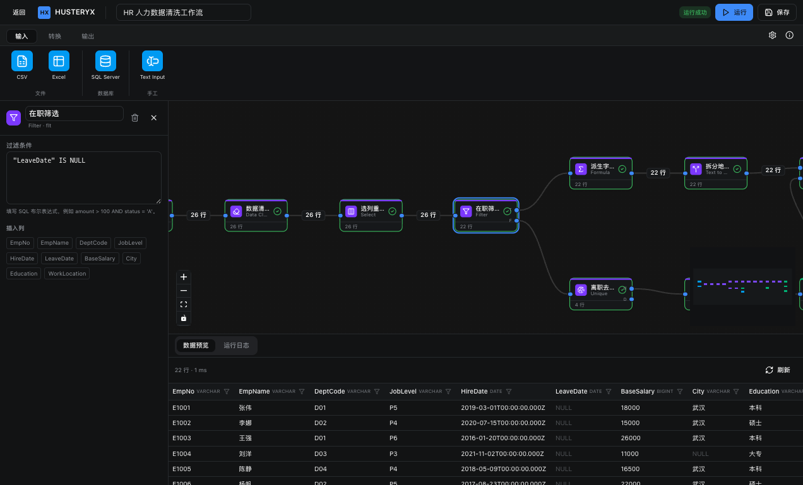

表达式框里是原生 SQL 风格的条件，写在里面的列名会在下方面板里列出来，不用背字段名。

然后是**派生字段（Formula）**，这次加了三个：

| 新字段 | 类型 | 表达式 |
| --- | --- | --- |
| Tenure | int64 | `date_diff('year', CAST("HireDate" AS DATE), DATE '2026-10-01')` |
| AnnualSalary | double | `"BaseSalary" * 12` |
| AgeBand | string | `CASE WHEN ... THEN '资深' / '骨干' / '新人' END` |

一个节点里可以加多条表达式，按顺序执行，后面的表达式能用到前面刚算出来的字段。日期类型的计算要先 `CAST` 成 DATE，这个坑和 Alteryx 里 Date 类型的处理逻辑差不多。

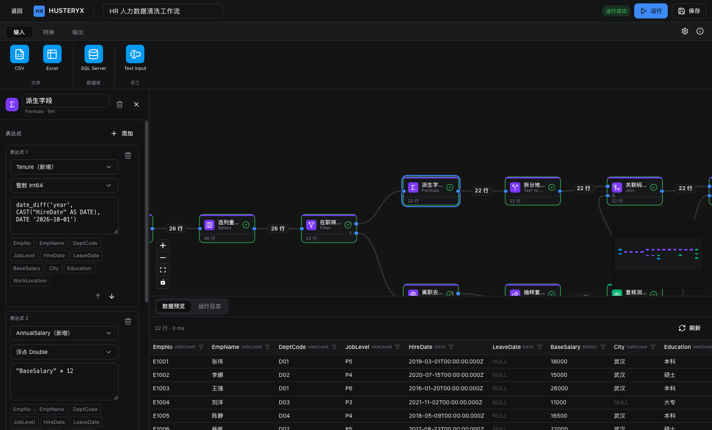

## 七、查找替换与文本分列

花名册里的部门代码是 `D01` 这种编码，人看着费劲，想先拿到一列中文部门名，所以先做一次**代码转名称（Find Replace）**：

- 查找字段（F 输入）：`DeptCode`；
- 查找表（R 输入）：部门码表；
- 替换值字段：`DeptName`；
- 输出方式：追加为新字段，新字段名叫 `DeptName`，区分大小写关掉。

清洗那步已经把代码统一成大写了，这里再把「区分大小写」关掉，两边写法不一致也不会漏匹配；输出的行里多一列中文部门名。

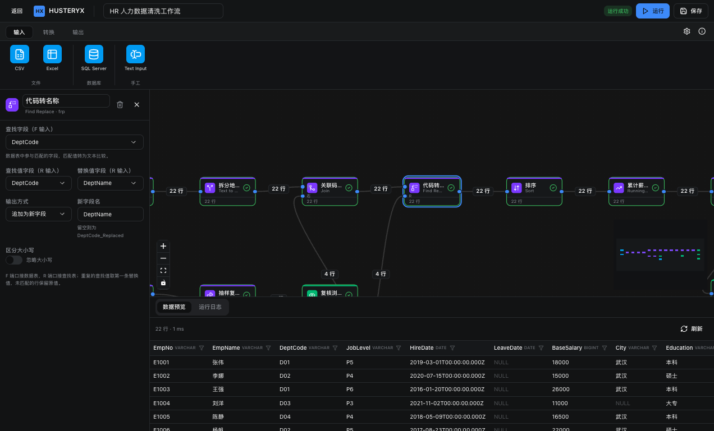

办公点字段是「武汉-3」这种拼接串，用**文本分列（Text to Columns）**拆开：

- 要拆分的字段：`WorkLocation`；
- 分隔符：自定义 `-`；
- 拆分方式：拆分为列；
- 拆分后的根名称：`Office`，列数 2。

结果就是 `Office1 = 武汉`、`Office2 = 3`。同一个节点也能选「拆分为行」，那就变成纵向展开。

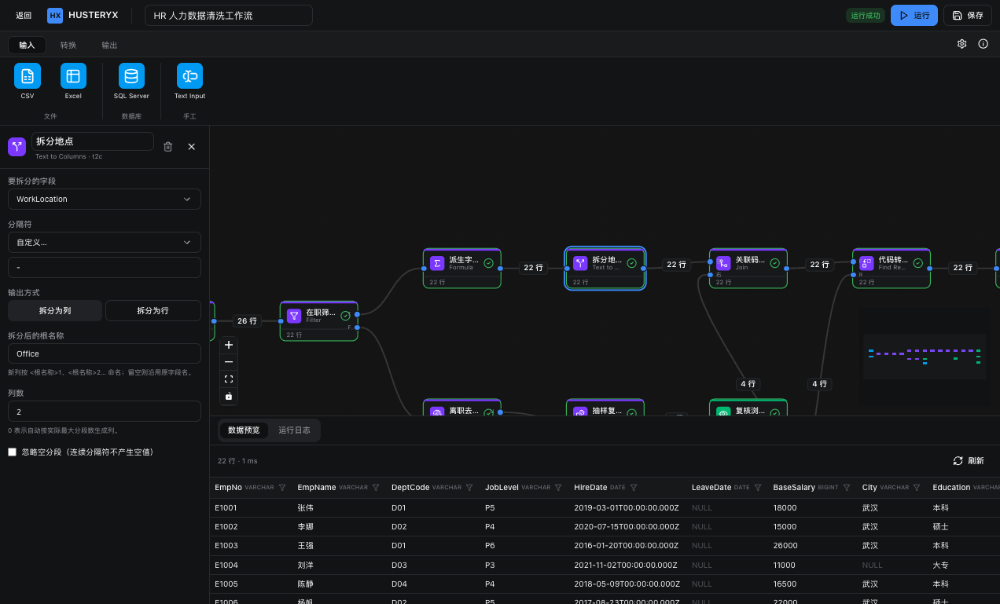

## 八、关联码表

**关联（Join）**是左连接：左边是花名册、右边是部门码表，连接键都选 `DeptCode`。输出字段可以逐列勾选、改别名、调整顺序，来源标明 `L`（左）还是 `R`（右）。

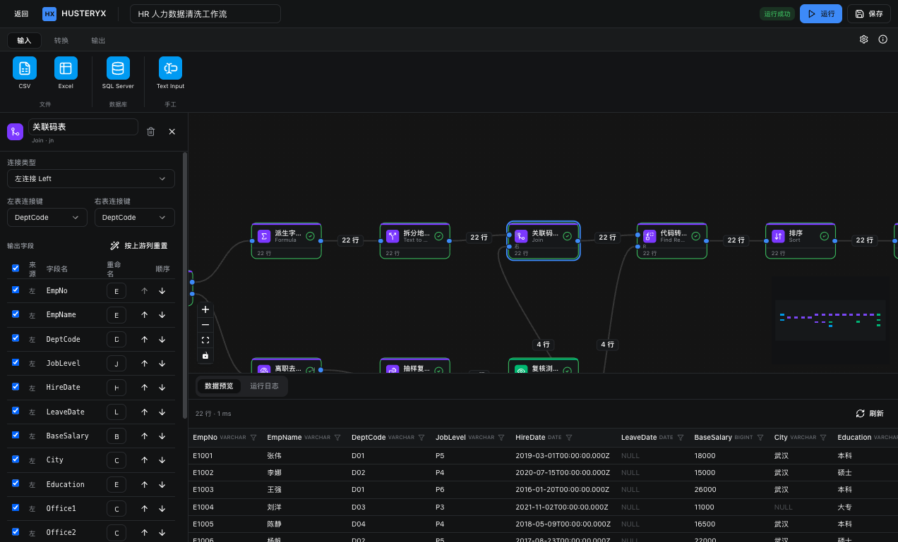

这次关联只为把码表里的「业务条线 BizLine」带进来，后面的排序要用它；中文部门名交给链路下一步的 Find Replace 去补。22 行进、22 行出，没有放大，说明码表是唯一的。

## 九、合并两个来源

总部和分公司是同一套字段结构，用**合并（Union）**竖着拼起来。Union 可以接多条入边，按连线顺序自上而下拼接；列对齐方式有「按列名」和「按位置」两种，这里选按列名——两家分公司的字段偶尔会缺一两列，按列名对齐会自动补 NULL。

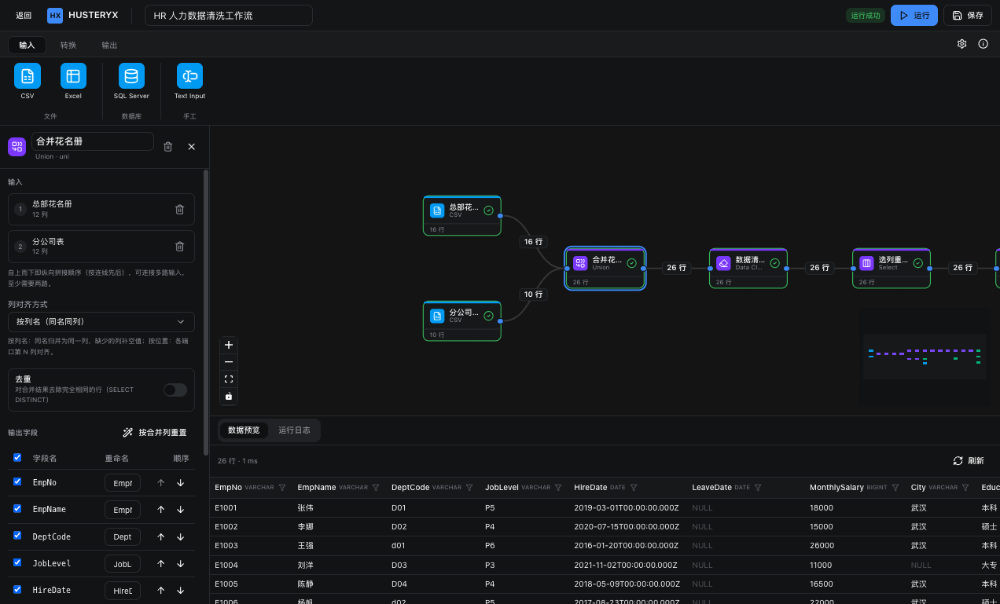

16 + 10 = 26 行。这个节点放在最前面，所以后面的清洗只需写一次。

## 十、去重与抽样

离职那 4 行从 Filter 的 F 端口出来，用**去重（Unique）**按 `EmpNo` 检查有没有重复记录——唯一值字段可以勾多列，选多列就是联合唯一。

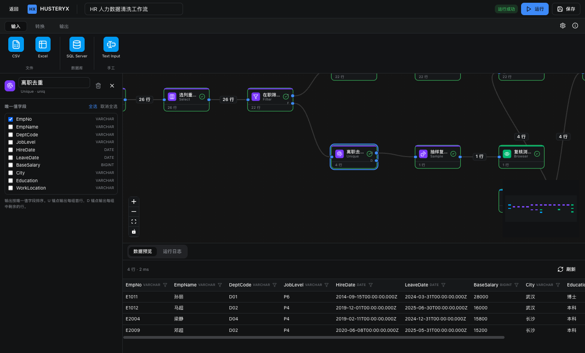

接着用**抽样（Sample）**取「前百分之 N 行」，N=20，抽 1 行出来人工核对。Sample 支持前 N 行、后 N 行、跳过前 N 行、每 N 行中的第一行、随机概率、前百分之 N 六种模式，还能按列分组每组各取 N 行——审计抽样那种「每个部门抽 2 条」就是用它。

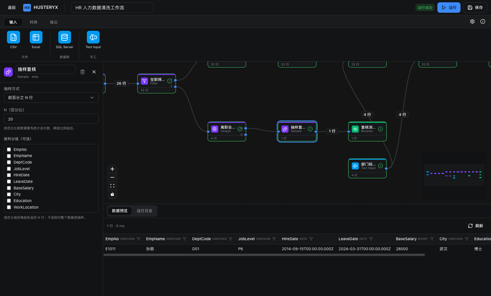

## 十一、排序与累计

**排序（Sort）**按两个键：`BizLine` 升序、`AnnualSalary` 降序，空值统一排在后面。

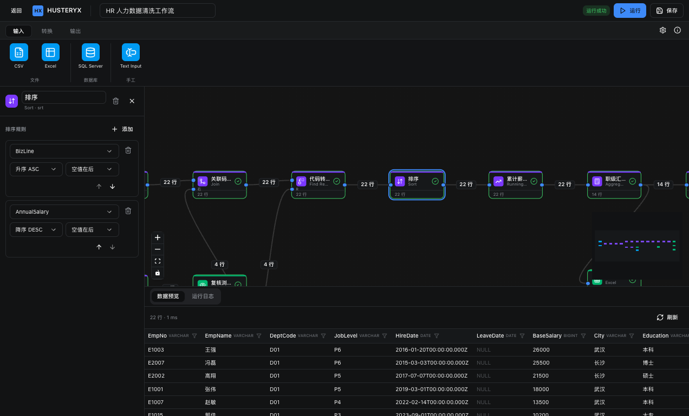

**累计（Running Total）**是个容易被忽略但很好用的节点：对 `AnnualSalary` 做累计，按 `DeptName` 分组——也就是每个部门内部各自从头累计出一列 `RunningAnnualSalary`。它和 Alteryx 一样不会自己排序，累加顺序就是记录进入节点的顺序，所以需要固定顺序时得先把 Sort 接在它前面（这次上面正好接了排序节点，顺序是确定的）。

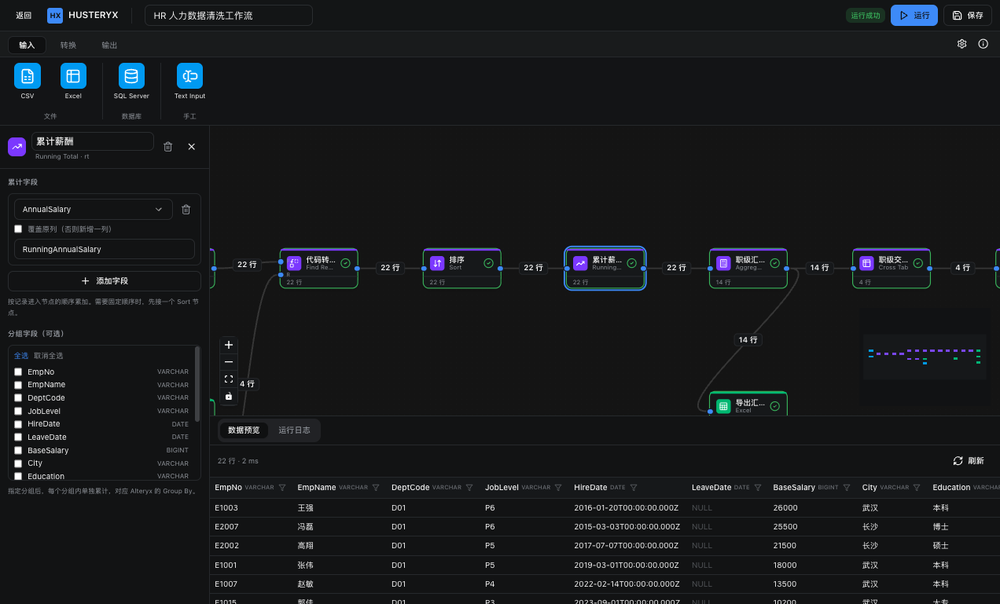

## 十二、按部门 × 职级汇总

**汇总（Aggregation）**两个分组字段：`DeptName`、`JobLevel`，四个聚合：

| 聚合 | 字段 | 输出字段名 |
| --- | --- | --- |
| COUNT | EmpNo | Headcount |
| SUM | BaseSalary | TotalBase |
| AVG | BaseSalary | AvgBase |
| MAX | AnnualSalary | MaxAnnual |

22 行汇总成 14 行。汇总节点支持 SUM / COUNT / AVG / MIN / MAX 五种聚合，这次用到了其中四个。

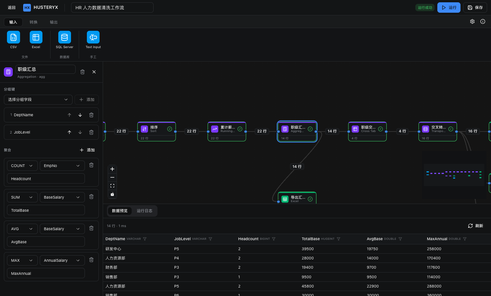

## 十三、交叉表与转置

**交叉表（Cross Tab）**把「部门 × 职级」的明细转成宽表：

- 表头字段：`JobLevel`（P3/P4/P5/P6 会变成列）；
- 值字段：`Headcount`；
- 取值方法：求和；
- 列名前缀：`L`；
- 分组字段：`DeptName`。

14 行变成 4 行 × 5 列（DeptName + LP3/LP4/LP5/LP6）。这里踩了个坑：第一次运行报「Cross Tab 字段不存在: EmpNo」，原因是值字段必须引用上游已经存在的列，得选 `Headcount` 而不是原始字段。

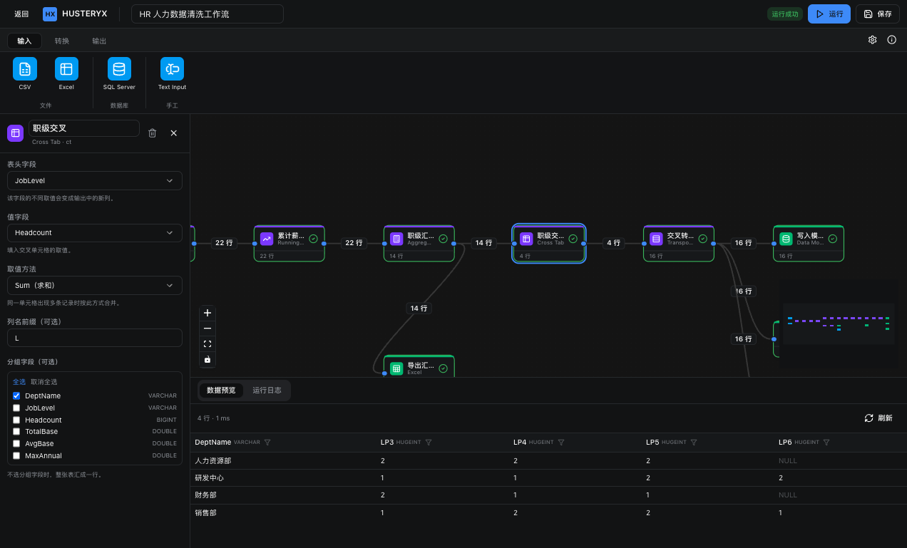

**转置（Transpose）**再把它转回长表：键字段 `DeptName`，数据字段勾选 `LP3/LP4/LP5/LP6`，输出固定是「键字段 + Name + Value」三列，4 行 × 4 职级 = 16 行。宽表给人看，长表给 BI 工具吃，这两个节点基本是配套用的。

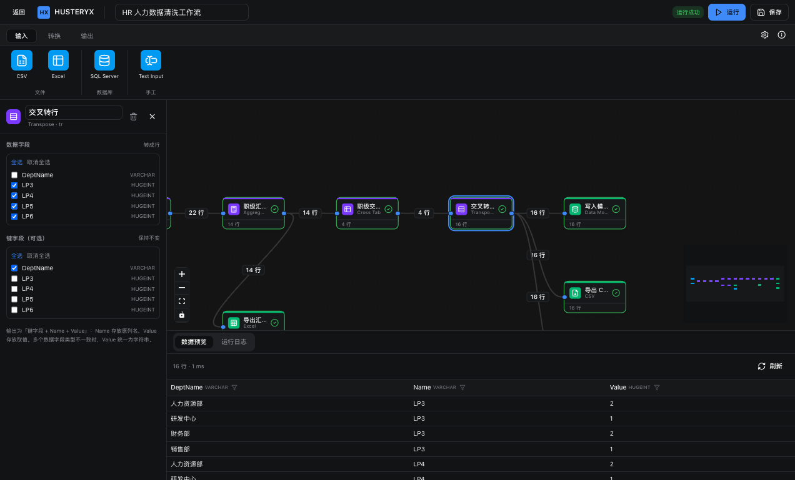

## 十四、输出：数据模型、文件与浏览

一条链路可以挂多个输出，这次挂了五个（其中两个是 Browser）：

**写入模型（Data Model）**：填模型名称 `HR_Headcount_By_Dept`，「同名模型已存在时」选覆盖。运行后节点卡片上照样显示 16 行，但它不在画布里留可预览的中间表——点开底部预览会提示没有可预览的输出表；结果要到「数据模型」模块里看，之后可以被仪表板直接当作数据集用。

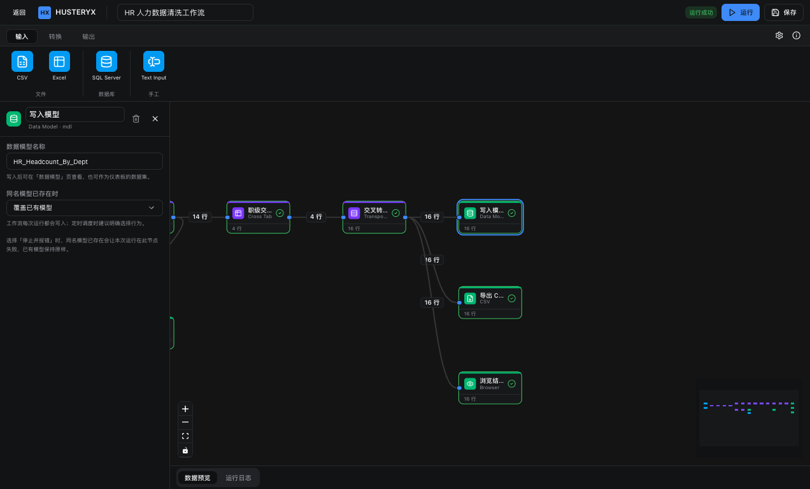

**导出到文件**：Excel 输出写 `hr_headcount.xlsx`，可以指定工作表名（这里是 `HC`）；同一条链路上还挂了一个 CSV 输出，用来给外部系统对接。

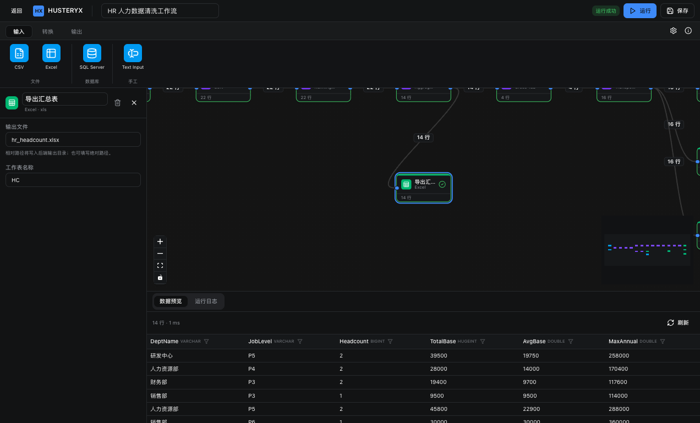

**浏览（Browser）**：不写任何东西，只是把数据停在面板里，方便人工看一眼。搭流程的时候我会在每个关键节点后面挂一个 Browser 看结果，确认没问题再删掉。

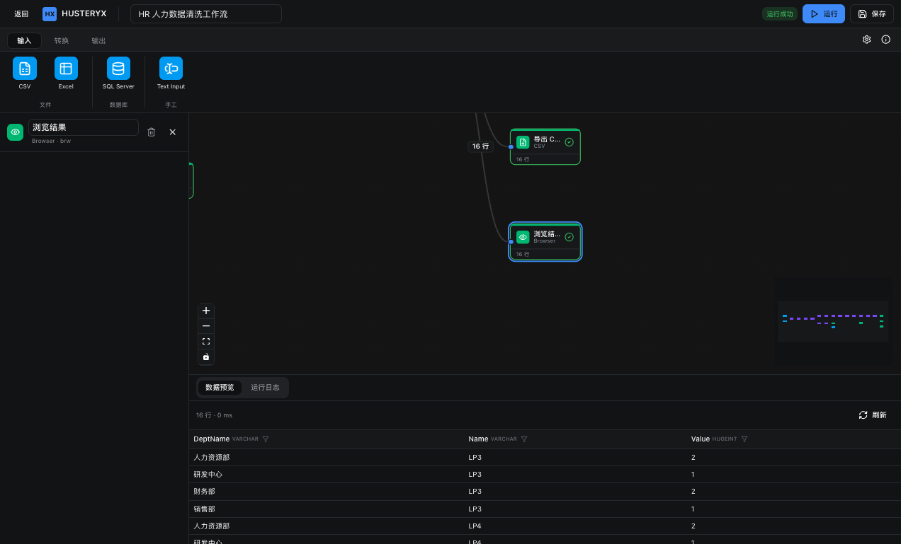

## 十五、运行：状态、行数与日志

右上角的「运行」是全量执行：按拓扑顺序跑完所有节点。跑的时候画布和配置会锁住，顶部提示「运行中，画布与配置已锁定」，节点整体置灰、底部面板显示「等待运行完成」。

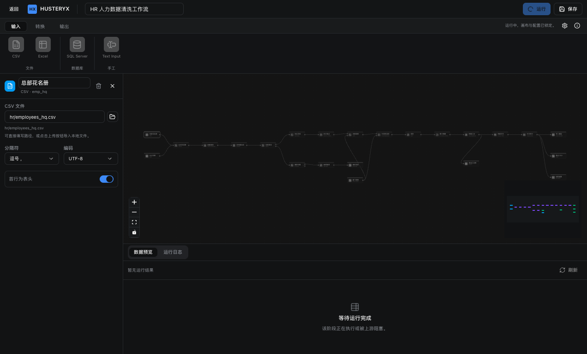

跑完之后：

- 每个节点卡片底部多出一行行数，右侧出现绿色对勾、边框变绿，右上角徽章变成「运行成功」；
- 配置不完整的节点右下角会出现橙色感叹号，悬停告诉缺哪一项——校验规则和真正执行前的校验是同一套；
- 点中任意节点，底部预览就只显示这一步的输出（没选节点时是空的）。

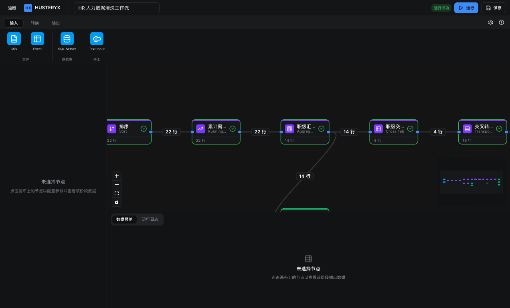

每次运行都会留一条记录：回到工作流详情页，在「运行历史」里点「查看日志」就能进到运行详情页，拿到这次运行的结构化结果——节点、类型、状态、行数、耗时、错误，以及完整执行日志（这次 23 个节点、72 条日志）。日志按 info / success / error 分级，哪一步慢、哪一步空，一眼就能看出来。

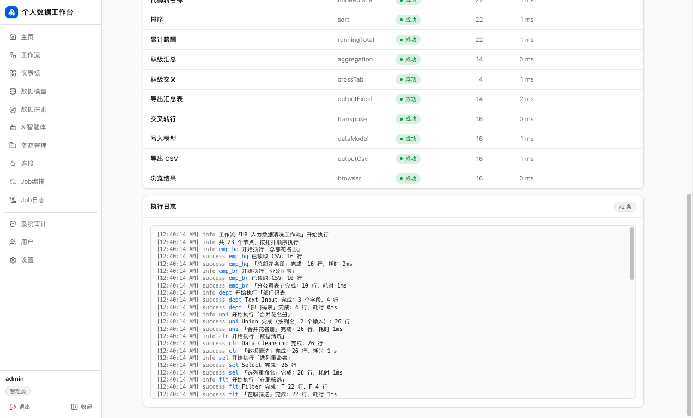

## 十六、右键菜单与缓存冻结

在节点上点右键，有三个动作：

- **运行至此**：只跑这个节点和它的全部上游，改完中间某一步不用从头来；
- **缓存至此**：跑一遍并把结果冻结住，后面的调参不再重复计算上游；
- **取消缓存**：解冻。

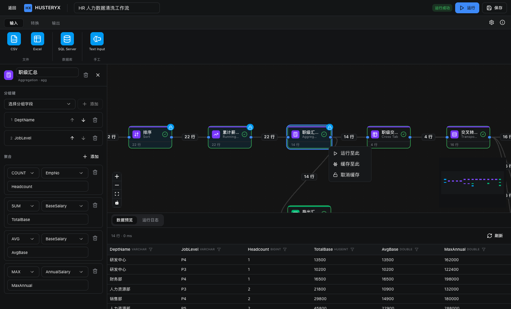

冻结之后，上锁的节点右上角会出现一个带锁的小圆点，底色变成淡蓝，并且不可编辑；已经缓存过的部分直接跳过，相当于 Alteryx 里把大表缓存下来的做法。数据量大的时候，这个功能能把「改一个下游参数、等三分钟」变成「改一个参数、等三秒」。

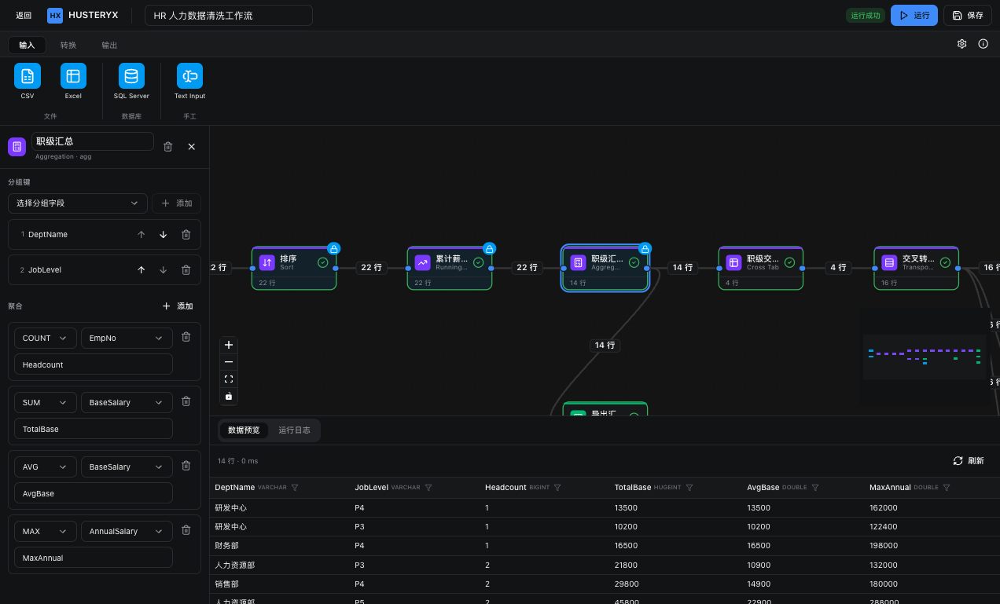

## 十七、全景

最后把画布缩到能看全的样子。整条链路是：

```
总部花名册 ┐
           ├→ 合并 → 数据清洗 → 选列重命名 → 在职筛选（T，22 行）→ 派生字段 → 拆分地点
分公司表   ┘                                                              ↑
                                                                     部门码表

拆分地点 → 关联码表 → 代码转名称 → 排序 → 累计薪酬 → 职级汇总 ┬→ 导出汇总表（Excel）
                                                              └→ 职级交叉 → 交叉转行 ┬→ 写入模型
                                                                                     ├→ 导出 CSV
                                                                                     └→ 浏览结果

在职筛选（F，4 行）→ 离职去重 → 抽样 → 复核浏览
```

23 个节点，左边一路清洗，中间一分为二做两种视角：一条走「明细 → 汇总 → 交叉 → 转行 → 输出」，另一条拿离职数据做核对；输出端同时写了数据模型、Excel、CSV，还留了两个 Browser 给人看。

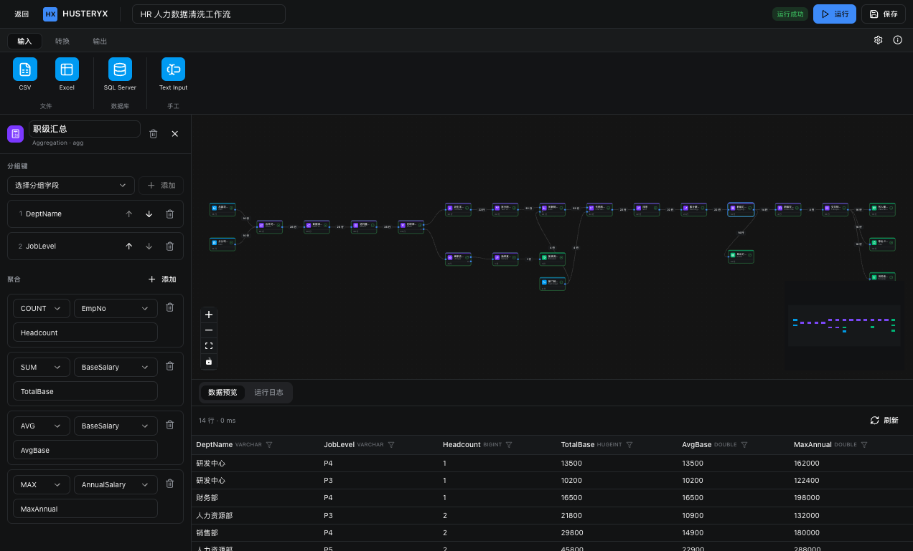

## 感受

回想起一年前，如果想这么顺利的实现到目前的效果，工作量会很大。现如今虽说从智能体和大模型跟顶流产品还有差距，但追赶的脚步从来没停下过。

后续会结合Power BI以及Alteryx的交叉功能，进一步探索个人工作台的功能。
