# HUSTServer 功能详细设计文档（FDD）

| 项 | 内容 |
| --- | --- |
| 文档名称 | HUSTServer 功能详细设计文档（Functional Detailed Design） |
| 版本 | v2.1 |
| 文档性质 | 按 REQ.md 功能清单逐一给出**操作步骤**与**界面原型图** |
| 关联文档 | REQ.md（需求文档）、README.md（功能总览） |
| 原型图目录 | docs/prototypes/（21 张 SVG 线框图） |
| 读者 | 产品、开发、测试、使用方 |

> 阅读约定：每节「界面原型」为 SVG 线框图，源文件位于 `docs/prototypes/`（720 宽，随窗口自适应）。图中 `▾` 表示下拉、`●` 表示选中态；灰色占位块表示省略内容。章节编号与 REQ.md §8 的映射表一一对应。

---

## 1. 整体界面框架（全局）

所有登录后的页面共用统一布局：左侧导航栏 + 右侧内容区。导航项按当前用户能力动态显示，底部为用户信息与退出。

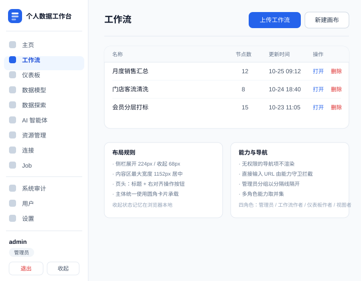

图 1 · 整体界面框架

- 「收起」把侧栏折叠为纯图标列（宽度 68px），状态记忆在本地。
- 无权限的导航项直接不显示；直接输入 URL 会被能力守卫拦截。
- 管理员专属分组（系统审计 / 用户 / 设置）以分隔线隔开。

---

## 2. 登录与会话（FR-01）

### 操作步骤

1. 打开系统任意地址，未登录时自动跳转登录页；
2. 输入用户名、密码，点击「登录」；
3. 校验通过后进入主页；失败提示「用户名或密码错误」（不区分用户名不存在与密码错误）；
4. 会话默认保持 7 天，期间刷新页面无需重新登录；
5. 点击侧栏底部「退出」清除会话并回到登录页。

### 界面原型

图 2 · 登录与会话

- 输入为空时按钮禁用；提交中按钮显示加载态。
- 首次部署：启动日志打印随机生成的管理员初始密码（仅一次）。

---

## 3. 用户与角色（FR-02）

### 操作步骤

1. 管理员进入「用户」页，查看用户列表（用户名 / 角色 / 状态 / 创建时间）；
2. 点击「创建用户」：填写用户名（3–32 位字母数字与 `_.-`）、密码（≥8 位）、勾选一个或多个角色，保存；
3. 行内菜单可「编辑角色 / 启用禁用」「重置密码」「删除」；
4. 禁用用户后该用户已登录会话立即失效；重置密码同样强制下线；
5. 管理员不能禁用或删除自己；点击用户名可查看其登录日志（成功 / 失败、时间、IP）。

### 界面原型

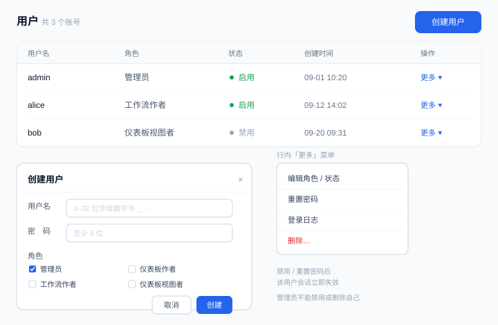

图 3 · 用户与角色

---

## 4. 工作流导入与创建（FR-03）

### 操作步骤

1. 进入「工作流」列表页；
2. 点击右上角「上传工作流」→ 选择本机 `.htyx` 文件（≤5MB）→ 系统解析出工作流名称、输入节点、输出节点；
3. 在「输入绑定」区为每个 CSV / Excel 输入选择「上传文件」（把本机文件传到服务端）或填写服务端绝对路径；
4. 确认无误后点击「创建」，跳转到工作流详情；
5. 也可点击「新建画布」从空白设计器开始搭建；
6. 列表行可进入详情、删除工作流。

### 界面原型

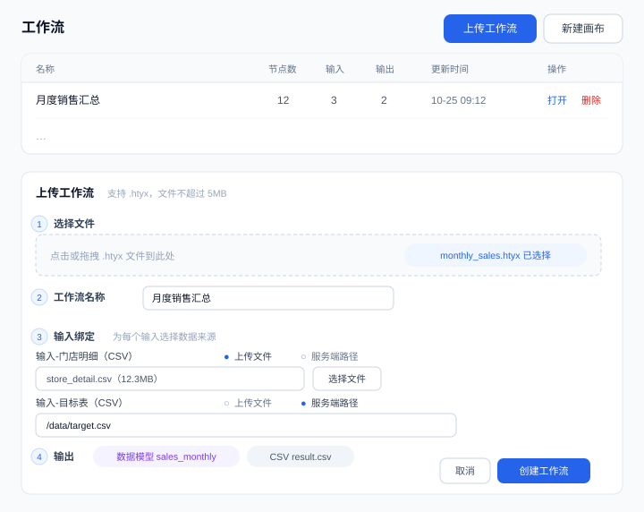

图 4 · 工作流导入与创建

---

## 5. 工作流设计器（FR-04）

### 操作步骤

1. 工作流详情页点击「设计器」进入画布；
2. 从左侧节点面板拖入节点（输入 / 准备 / 聚合 / 排序 / 输出五组），画布上连线表示数据流向；
3. 点选节点后在右侧属性面板配置：如筛选节点填 SQL 布尔表达式、联接节点选类型与关联字段、公式节点按序添加表达式（后面的公式可引用前面的新列）；
4. 节点右键或工具栏可重命名、禁用（旁路，数据直通下游）、删除；选中连线可删除；
5. 每个节点底部「预览」按钮可查看该节点输出样例数据；
6. 点击「保存」落库；SQL 节点的连接信息自动剥离为私有连接（见 §7）。

### 界面原型

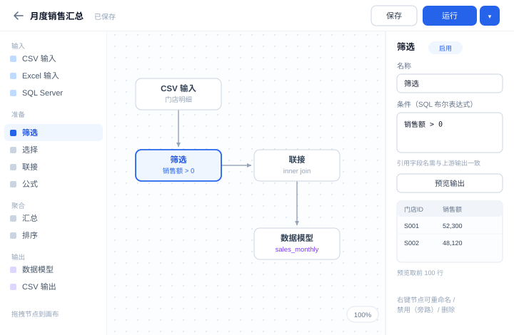

图 5 · 工作流设计器

- 画布支持四种主题（午夜 / 石墨 / 日光 / 海洋，见 §21）。
- 节点状态色：灰=未运行，蓝=运行中，绿=成功，红=失败，浅灰=禁用/跳过。

---

## 6. 工作流数据连接绑定（FR-05）

### 操作步骤

1. 工作流详情页点击「数据连接」标签，列出全部 SQL Server 输入/输出节点；
2. 逐节点选择连接方式：`(●) 系统连接`（下拉选择共享或自己的连接）或 `( ) 私有连接`（填写服务器、端口、数据库、用户名、密码）；
3. 输入节点还需选择目标：`(●) 表/视图`（下拉列出该库对象）或 `( ) 自定义 SQL`（文本域）；
4. 密码栏显示 `******`，留空保存表示不修改原密码；
5. 点击「测试」做 TCP 连通性检查，成功提示可达；
6. 保存后连接配置加密存放，工作流 JSON 中不含明文。

### 界面原型

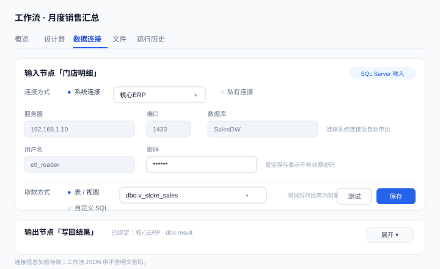

图 6 · 数据连接绑定

---

## 7. 运行与实时监控（FR-06）

### 操作步骤

1. 工作流详情页点击「立即运行」（或设计器内「运行 ▼」选择「运行到选中节点」）；
2. 系统排队（并发默认 2）后开始执行，节点结果表实时刷新状态与行数；
3. 运行中可点击「取消」，剩余节点不再执行；
4. 运行成功后点击任意节点查看输出数据预览；
5. 需要断点续跑时：发起「冻结运行」，成功后获得缓存令牌；下次勾选「从缓存续跑」并粘贴令牌，已缓存节点显示「使用缓存结果」，从缓存之后继续执行；缓存失效时提示重新冻结。

### 界面原型

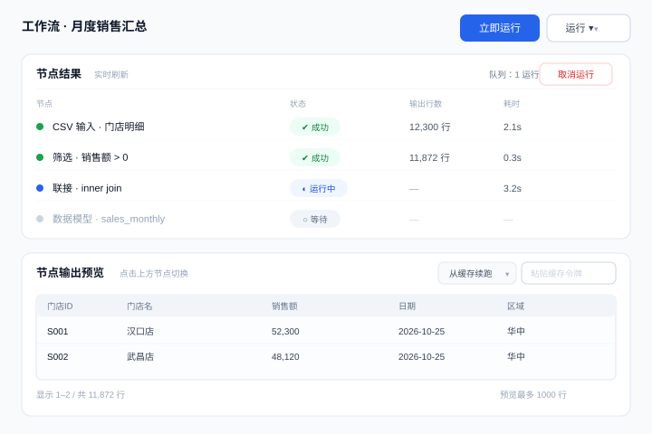

图 7 · 运行与实时监控

---

## 8. 运行历史与日志（FR-07）

### 操作步骤

1. 工作流详情页「运行历史」标签：列表显示触发方式（手动 / 调度 / Job）、状态、开始时间、耗时、触发人；
2. 点击某次运行进入运行详情：上半部分为节点结果表，下半部分为执行日志；
3. 日志支持按节点过滤与增量加载（滚动到底继续拉取）；
4. 失败运行的错误信息在详情顶部醒目展示。

### 界面原型

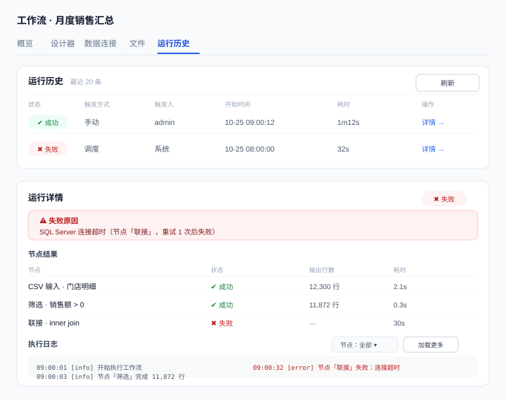

图 8 · 运行历史与日志

---

## 9. 定时调度（FR-08）

### 操作步骤

1. 工作流详情页「调度」区点击「新建调度」；
2. 选择频率：`(●) 每天 ( ) 每周 ( ) 每月 ( ) Cron 表达式`，并填写时间（每周选星期，每月选日期；Cron 直接填 5 段表达式）；
3. 时区默认 Asia/Shanghai，可修改；
4. 保存后列表显示「下次运行时间」；行内可启用/停用、编辑、删除；
5. 调度触发后运行历史的触发方式显示「调度」。

### 界面原型

图 9 · 定时调度

---

## 10. Job 编排（FR-09）

### 操作步骤

1. 进入「Job」列表，点击「新建 Job」，输入名称与描述；
2. 在编排画布中从左侧面板拖入步骤节点：`工作流`（选择工作流）、`SQL`（选择连接并填写语句）、`加载成模型`（选择来源与模型名）；
3. 连线表示依赖：只有上游全部完成，下游才执行；不同分支可并行；
4. 选中步骤在右侧属性面板配置：失败策略 `中止下游 / 继续其他分支`，运行模式 `运行 / 跳过 / 禁用`（禁用连同其下游一并跳过）；
5. 打开「调度设置」为 Job 配置与工作流相同的频率模型；
6. 保存时校验无环、无非法连线；通过「导出 / 导入」按钮可下载或上传 `.job.json` 完成跨环境迁移（导入时按名称重匹配连接与工作流，未匹配项列入告警）。

### 界面原型

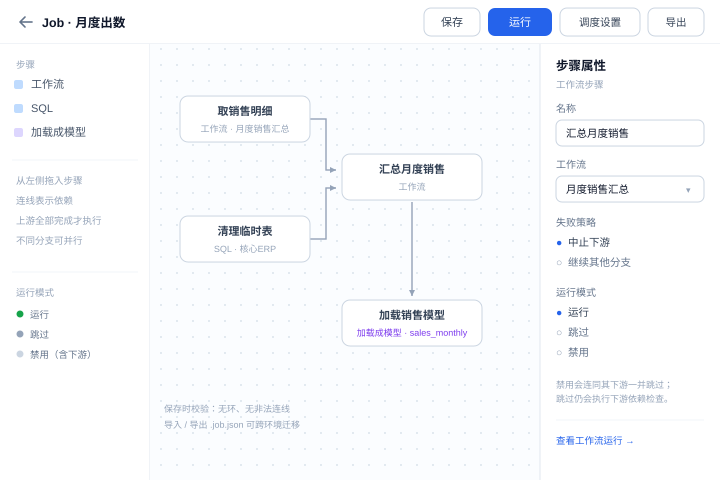

图 10 · Job 编排

---

## 11. Job 运行与日志（FR-10）

### 操作步骤

1. Job 画布或列表点击「运行」，返回异步受理（已启动提示）；
2. 「Job 日志」标签或列表页「日志」Tab：查看全部 Job 运行（Job 名、触发方式、状态、开始时间、耗时）；非管理员只看到自己触发的；
3. 点击某次运行进入详情：顶部「运行概览」（状态 / 时间 / 错误）、中部「运行流程」（按编排图渲染节点与状态色）、下方「步骤明细」（每个步骤的类型、配置摘要、状态、耗时）；
4. 工作流步骤可点开跳转到对应工作流运行详情，查看节点级日志；
5. 运行中的 Job 可「取消」：未开始步骤全部标记为跳过。

### 界面原型

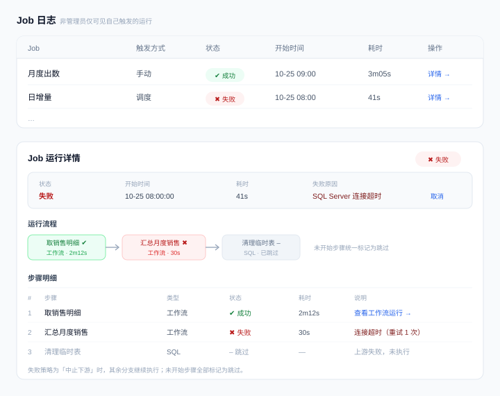

图 11 · Job 运行与日志

---

## 12. 数据连接（FR-11）

### 操作步骤

1. 进入「连接」页，列表展示名称、服务器、数据库、共享标记；
2. 点击「新建连接」：填写名称、服务器、端口（默认 1433）、数据库名、用户名、密码；管理员可勾选「共享给所有用户」；
3. 保存前可点「测试连接」：真实连库，成功后列出该账号可见的数据库供选择；
4. 编辑时密码显示为掩码，留空保存表示不修改；删除需二次确认；
5. 非管理员仅能看到共享连接与自己创建的连接，且不能修改他人的连接。

### 界面原型

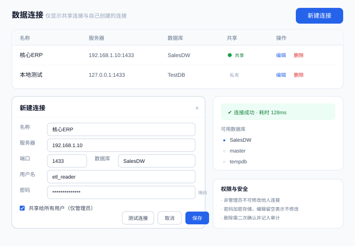

图 12 · 数据连接

---

## 13. 资源库（FR-12）

### 操作步骤

1. 进入「资源管理」页：左侧为目录树，右侧为当前目录的文件列表（名称、大小、修改时间）；
2. 工具栏支持：新建文件夹、上传文件（CSV / Excel / XLS，≤200MB）、下载；
3. 行内菜单支持重命名、移动（选择目标目录）、删除（二次确认）；
4. 点击 Excel 文件可查看工作表列表；同名冲突时提示 409 并要求改名；不允许把目录移动到其自身子目录；
5. 删除 / 移动 / 重命名均记入系统审计。

### 界面原型

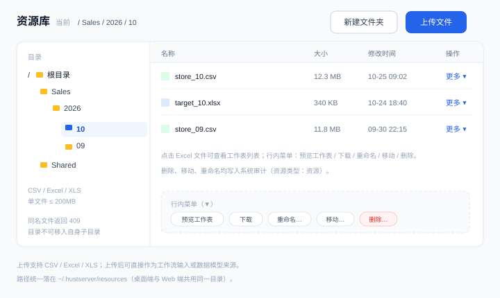

图 13 · 资源库

---

## 14. 数据模型（FR-13）

### 操作步骤

1. 进入「数据模型」页：列表显示模型名、来源徽标（CSV / Excel / SQL Server / 工作流输出 / 系统审计）、行数、列数、加载时间；
2. 点击「新建模型」：选择来源——`(●) 资源文件`（选资源库 CSV/Excel）或 `( ) SQL Server`（选连接 + 表/视图或 SQL）；填写模型名（字母数字下划线，≤64 字符）；同名时选择 `覆盖` 或 `报错`；
3. 「预览」打开数据表格（默认 1000 行）；
4. 行内菜单「数据标签」：用 Markdown 描述字段口径（≤2 万字符），内容同时供 AI 智能体参考；
5. 行内菜单「列配置」：为文本列指定显示类型（数值 / 日期 / 布尔等），图表与预览按新类型呈现；
6. 行内菜单「重命名」：确认后同步迁移列配置与标签，并提示已引用旧名的仪表板需更新；「删除」同步清理配置与标签。

### 界面原型

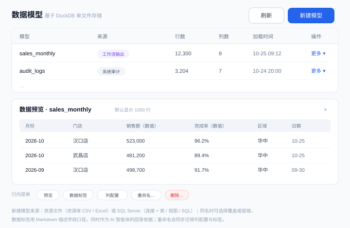

图 14 · 数据模型

---

## 15. 仪表板（FR-14）

### 操作步骤

1. 进入「仪表板」列表：点击名称以**预览（只读）**打开，操作列「编辑」进入编辑器；「新建」创建空白仪表板；
2. 编辑器左侧为「数据」面板：添加数据集（资源文件 / SQL 查询 / 数据模型），展开字段列表；
3. 从「可视化」面板选择图表类型（柱形、条形、折线、面积、饼/环形、散点、地图、树图、表格、矩阵、切片器、文本框、图像、形状、按钮等 25 种）；
4. 拖字段到「字段」井（轴 / 图例 / 值 / 提示）；「格式」面板调整颜色、坐标轴、标题等；
5. 顶部功能区分组：插入 / 页面 / 导出 / 主题 / 对齐 / 视觉对象 / 元素 / 页面视图 / 显示 / 窗格；
6. 「筛选器」面板设置三级筛选：所有页面 / 此页 / 此视觉对象；切片器可跨页同步；
7. 「书签」面板捕获当前筛选与显隐状态，一键应用；
8. 底部页面标签可增删页面、重命名；页面默认 1280×720，可自定义；
9. 「导出」输出 PNG / 整页 PDF；视觉对象右键可「查看数据」「导出数据」「焦点模式」；演示模式全屏放映。

### 界面原型

图 15 · 仪表板

---

## 16. 数据探索（FR-15）

### 操作步骤

1. 进入「数据探索」页，选择数据源：`(●) 数据模型` 或 `( ) 数据连接`；
2. 连接方式下选择库对象（表 / 视图），系统自动展示列结构；
3. 在 SQL 编辑器（Monaco）中编写查询，**仅允许一条只读 SELECT / WITH 语句**；
4. 点击「运行」：模型源走模型库查询，连接源直连 SQL Server（带超时）；
5. 结果区显示列头与行数据；多语句或非查询语句被拒绝并提示原因；结果超过上限自动截断并提示；
6. 结果可导出 CSV。

### 界面原型

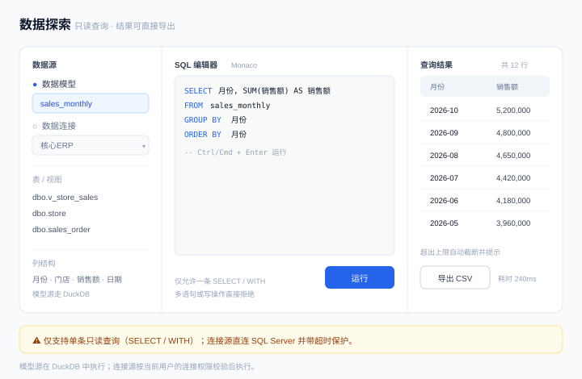

图 16 · 数据探索

---

## 17. AI 智能体（FR-16）

### 操作步骤

1. 进入「AI 智能体」页：左栏为会话列表，「新建对话」开始提问；
2. 可在提问框下方选择「限定模型」（只允许基于该模型回答，并引用其数据标签作为口径）；
3. 输入问题（≤4000 字符）发送：系统生成只读 SQL → 自动校验与执行 → 返回结论文字 + 数据表格 + 所用 SQL（可展开）；
4. 未配置 API Key 时提示到「设置 → AI 智能体」配置；
5. 会话过长时点击「查看会话长度」，在弹窗中「压缩历史」：把旧消息压缩为摘要，后续对话基于摘要 + 最近消息继续；
6. 会话可重命名、删除；历史消息始终可回看。

### 界面原型

图 17 · AI 智能体

---

## 18. 系统审计（FR-17）

### 操作步骤

1. 管理员进入「系统审计」页；
2. 顶部筛选：动作（创建 / 更新 / 删除 / 登录 / 登录失败 / 其他）、资源类型（工作流 / 仪表板 / 模型 / 资源 / 连接 / Job / 用户 / 认证）；
3. 列表展示时间、操作人、动作、资源类型、资源名、描述，分页浏览；
4. 点击「加载为模型」把审计记录导入固定模型 `audit_logs`，供仪表板分析使用。

### 界面原型

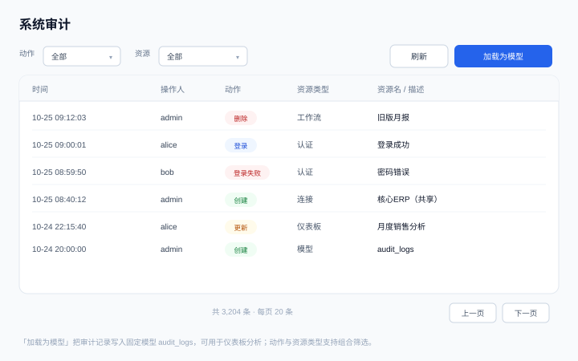

图 18 · 系统审计

---

## 19. 主页概览（FR-18）

### 操作步骤

1. 管理员登录后默认进入主页；
2. 顶部六张数量卡片：工作流 / 仪表板 / 数据模型 / 连接 / Job / 用户；
3. 下方「新建趋势」区：七组近 N 天折线（前六类 + 审计独占一行）；可切换统计天数（默认 30，1–365）；
4. 无数据的日期补 0 画线，保证曲线连续。

### 界面原型

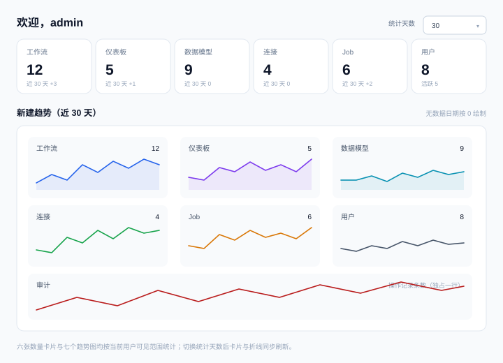

图 19 · 主页概览

---

## 20. 系统设置（FR-19）

### 操作步骤

1. 管理员进入「设置」页，六张设置卡片自上而下：
2. **运行**：最大并发运行数（正整数）、日志保留天数（正整数）；
3. **存储**：共享目录白名单（每行一个绝对路径，供工作流读写服务端文件）；
4. **时间**：时区（非空，默认 Asia/Shanghai）；
5. **界面外观**：界面主题（经典 / 午夜 / 石墨 / 日光 / 海洋）——影响全站配色；**画布外观**：设计器画布主题（四种之一）；
6. **AI 智能体**：API 地址（http(s) 开头，自动去尾斜杠）、模型名、API Key（掩码显示，留空表示不修改；保存后加密存储）；
7. 点击「保存」立即生效（并发数影响排队，主题即时切换）。

### 界面原型

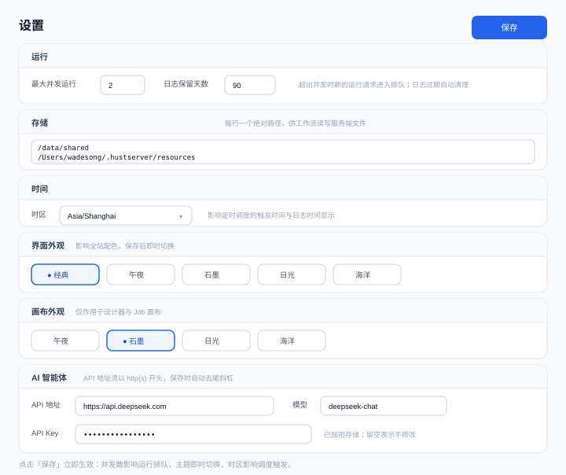

图 20 · 系统设置

---

## 21. 桌面端（FR-20）

### 操作步骤

1. 双击 `HUSTServer.app`（macOS Apple Silicon）启动；
2. 应用自动在后台拉起内置服务（仅监听 127.0.0.1 随机端口），窗口自动打开并进入登录页；
3. 账号与 Web 版共用（同一数据目录 `~/.hustserver`）：同一账号在桌面端与浏览器端看到相同的工作流、模型与仪表板；
4. 使用方式与 Web 版完全一致（本 FDD 其余章节）；
5. 关闭窗口即完全退出，后台服务随之结束，无残留进程。

### 界面原型

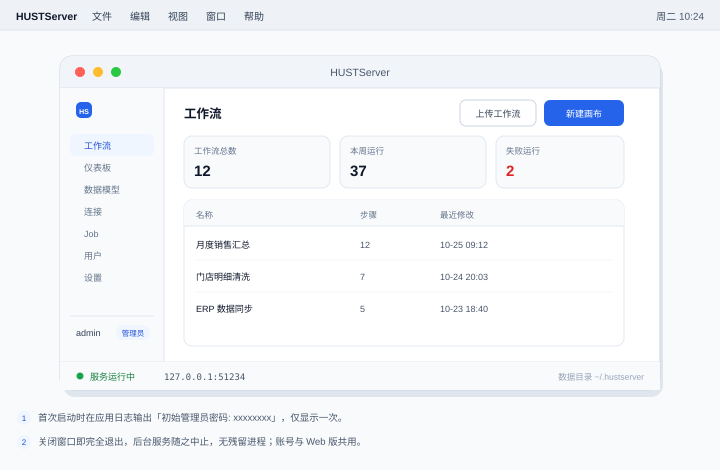

图 21 · 桌面端

---

## 附录 A：页面与路由索引

| 路由 | 页面 | 所需能力 |
| --- | --- | --- |
| /login | 登录 | 公开 |
| / | 主页概览 | admin |
| /workflows、/workflows/new、/workflows/:id、/workflows/:id/designer、/workflows/:id/connections | 工作流各页 | workflow |
| /dashboards、/dashboards/:id、/dashboards/:id/preview | 仪表板 | dashboard.view |
| /jobs、/jobs/new、/jobs/:id、/job-runs/:id、/runs/:id | Job 与运行 | job |
| /connections | 数据连接 | connection.manage |
| /resources | 资源库 | resources |
| /models | 数据模型 | dashboard.view |
| /explore | 数据探索 | connection.use |
| /assistant | AI 智能体 | connection.use |
| /audit、/users、/settings | 管理页 | admin |

## 附录 B：节点清单（设计器 / Job）

- **设计器 24 种节点**：CSV 输入、Excel 输入、SQL Server 输入、文本输入、选择、筛选、联接、查找替换、合并、公式、唯一、抽样、清理、运行总计、文本转列、交叉表、转置、浏览、汇总、排序、数据模型、CSV 输出、Excel 输出、SQL Server 输出。
- **Job 3 种步骤**：工作流、SQL、加载成模型（失败策略与运行模式见 §10）。
