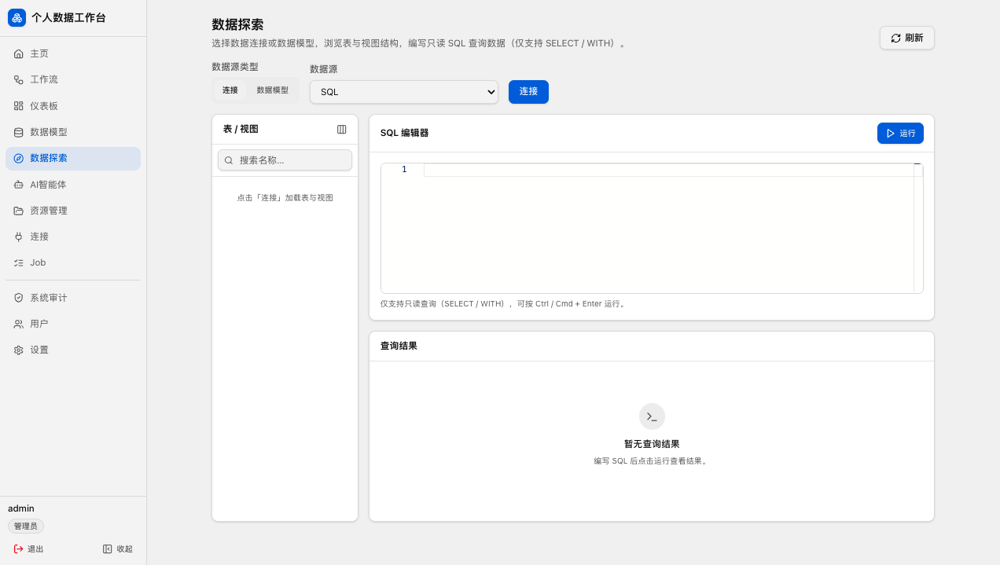
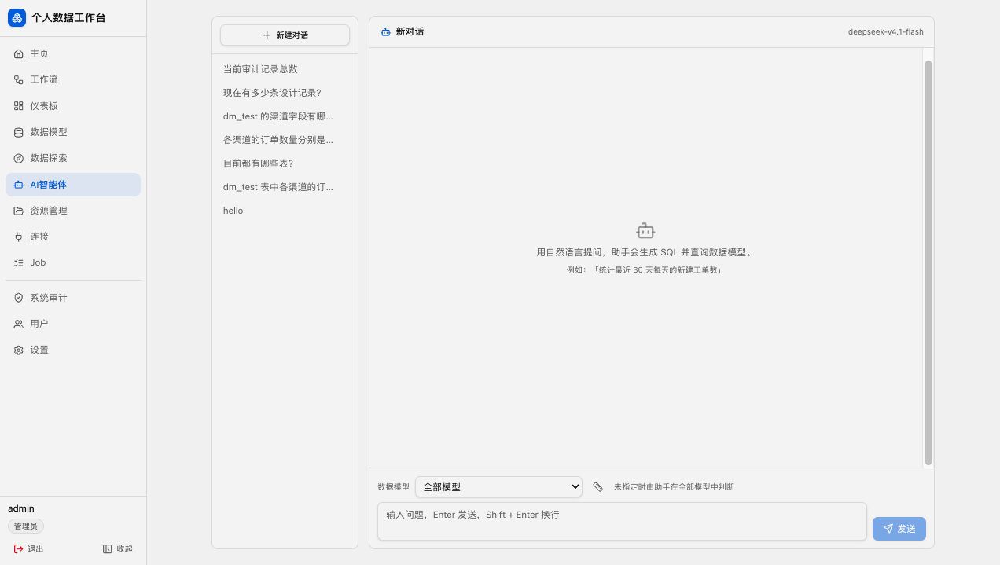
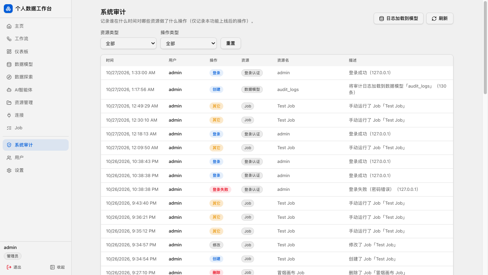
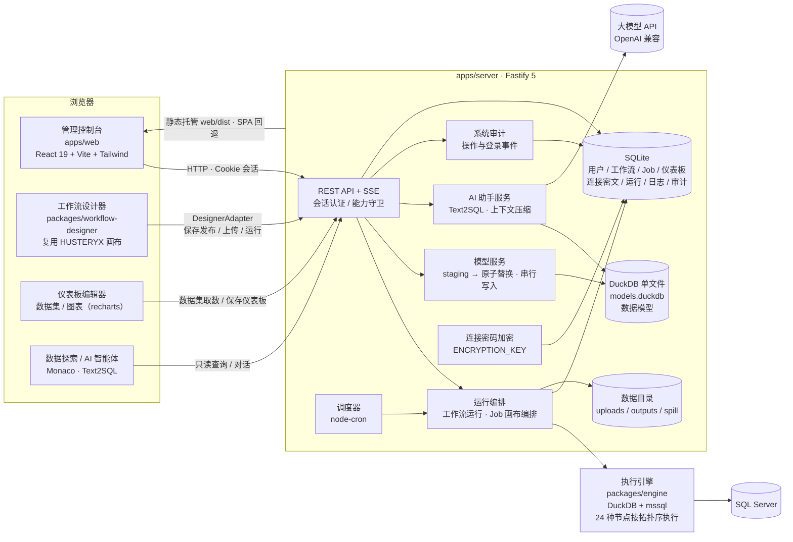

# 个人数据工作台

这个项目是我基于Alteryx，Power BI，SQLServer SSIS等搭建的一整套个人数据中台/工作台；平台负责任务编排（Job）、运行调度与日志、数据连接与资源文件管理，并提供 **仪表板** 与 **数据模型** 等数据应用能力。

## 功能总览

- 上传、托管并运行 `.htyx` 工作流；**Web 工作流设计器**浏览器内拖拽搭建（24 种节点，支持节点搜索与编辑器内直接运行预览，保存即发布）
- **Job 编排**：全屏画布式编排，把「运行工作流 / 运行 SQL / 加载成模型」作为节点拖拽连线，节点属性面板配置失败策略（中止 / 继续）；支持撤销重做、整理布局、`⌘S` 保存、底部实时运行输出，以及 `.job.json` 导入 / 导出
- 手动运行 + Cron 调度，工作流节点级状态与实时日志（SSE）；`Job` 页分「编排 / 日志」两个 Tab，**Job 日志**按每次运行记录（运行时间、触发方式、结果、耗时、错误），支持分页加载与运行详情弹窗
- **仪表板**：数据集可来自资源库文件（CSV / Excel）、SQL 查询或**数据模型**，拖拽搭建图表与报表；内置 25 种视觉对象（含切片器、文本框、图像、形状、按钮），支持多页面、三级筛选器（所有页面 / 此页 / 此视觉对象）、切片器跨页同步、书签、演示模式与导出 PNG / PDF；对所有具备查看能力的用户可见
- **数据模型**：把资源库 CSV / Excel、SQL Server 表 / 查询、工作流输出或系统审计加载进持久 DuckDB 单文件，按模型名复用；页内支持**新建模型**、**数据预览**、拖拽式**透视**、整表**统计**、Markdown **数据标签**与**列类型配置**
- **数据探索**：选择数据连接或数据模型，浏览表 / 视图与列结构，在 Monaco 编辑器中编写只读 SQL（SELECT / WITH）并查看结果
- **AI 智能体**：用自然语言提问，由大模型生成 SQL 并查询数据模型（Text2SQL）；支持多会话、上下文压缩与会话长度统计
- **资源库**：文件夹树管理，上传 CSV / Excel，供工作流输入节点与「加载成模型」步骤引用
- SQL Server 连接管理（密码加密存储、界面掩码显示、可按工作流单独维护）
- 用户与**四角色八能力**权限（管理员 / 工作流作者 / 仪表板作者 / 仪表板用户），多角色可叠加；**登录日志**记录每次登录的成功 / 失败、IP 与客户端
- **系统审计**：记录谁在什么时间对哪个资源做了什么操作，支持按资源 / 操作过滤、分页浏览，并可一键加载为 `audit_logs` 数据模型供分析
- **主页看板**（仅管理员）：六类资源的数量卡片，以及七张新建 / 记录趋势折线图（审计记录趋势独占整行）
- 系统设置（并发数、日志保留期、共享目录、时区、**界面主题**、**画布主题**、**AI 智能体接口**）

## 界面一览

### 登录

所有页面均需登录访问；首次启动自动创建初始管理员。


### 主页看板

左侧栏最上方的 `主页`（仅管理员可见）。顶部是六张数量卡片——工作流、仪表板、数据模型、连接、Job、用户，点击卡片跳转到对应列表；下方 `新建趋势` 按天展示七组数据，可切换最近 7 / 30 / 90 天：最上方是**审计**记录趋势（占满一整行），其下依次为工作流、仪表板、数据模型、连接、Job、用户的新建数量，均为直线段折线图。


### 工作流列表

查看全部工作流，支持删除，并可从「上传工作流」「新建画布」两个入口创建。


### 上传工作流与数据绑定

上传 HUSTERYX 导出的 `.htyx` 工作流文件，为输入节点上传 CSV / Excel 数据文件并建立路径映射，使作者本机路径在服务端重新落地。


### 工作流详情与调度

查看工作流信息与运行历史，支持手动立即运行，并可配置 Cron 调度自动执行。页面顶部提供 `返回列表` 与 `编辑画布` 两个入口，可随时回到列表或进入设计器。


### Web 工作流设计器

内置完整画布设计器（复用 HUSTERYX 前端）：顶部是工具栏（返回、工作流名称、撤销 / 重做、**运行** / **停止**、保存）与「输入 / 转换 / 输出」Ribbon（支持按名称搜索节点）；左侧为节点配置面板，中间是画布，底部为「数据预览 / 运行日志」面板。支持 **24 种节点**（CSV / Excel / SQL Server / Text Input 输入，Select / Filter / Join / Find Replace / Union / Aggregation / Sort / Formula / Unique / Sample / Data Cleansing / Running Total / Text to Columns / Cross Tab / Transpose 转换，CSV / Excel / SQL Server / Browser / Data Model 输出），拖拽连线、成环检测与端口约束、节点配置面板编辑；既可从「新建画布」从零搭建，也可从列表 / 详情进入编辑既有工作流，保存即发布到平台。保存后可直接在编辑器内点 `运行`，按拓扑顺序执行并在底部查看每个节点的输出数据与运行日志。


### Job 编排

把多个动作编排成一条流水线一次运行。`Job` 页顶部用「**编排** / **日志**」两个 Tab 切换；编排视图列出全部 Job（名称、节点数、调度、最近运行、更新时间），支持 `.job.json` 导入 / 导出与立即运行。

编辑器是全屏画布：顶部工具栏提供返回、撤销 / 重做、整理布局、`设置`（名称、描述与调度）、`保存`、`运行`；其下是「工作流 / 数据处理」两组组件 Ribbon（拖入画布或点击添加），左侧为节点属性面板，中间画布拖拽连线，底部「运行输出」展示最近一次运行的逐步状态与详细日志。节点类型支持「**运行工作流**」「**运行 SQL**」「**加载成模型**」，每个节点可设失败策略（中止 / 继续）与运行模式（正常运行 / 跳过 / 禁用并连带下游），未完成的必填项会在节点卡与属性面板提示。支持手动立即运行与 Cron 调度。

工作流（Workflow）是 HUSTERYX 的节点画布，Job 是更高一层的编排容器：可把若干工作流、SQL 语句与数据模型加载串成一条有序流水线。


### Job 日志

`Job` 页的 `日志` Tab 按**每次运行**倒序列出全部 Job 的运行记录：`运行时间`、`Job 名称`、`触发方式`（手动 / 定时）、`运行结果`、`耗时`、`错误` 与操作。每页加载 50 条，底部 `加载更多` 继续拉取；点行内 `详细` 打开「运行详情」弹窗，查看状态、开始 / 结束时间、耗时与步骤明细，也可点 `完整页面` 跳到独立运行详情页。


### 仪表板

Power BI 风格的报表编辑器：左侧切换「仪表板 / 数据」两个视图，中部是功能区（`开始` / `插入` / `视图`）与多页面画布，右侧为「筛选器 / 可视化 / 数据 / 选择」窗格，拖拽字段即可成图。数据集有三种来源——**资源库文件**（CSV / Excel）、**SQL 查询**（数据连接）、**数据模型**（DuckDB）；内置 25 种视觉对象：柱状 / 条形 / 折线 / 面积 / 组合 / 饼 / 环 / 散点 / 树图 / 漏斗 / 径向 / KPI / 表格 / 数据透视表等图表，以及**切片器**、文本框、图像、形状与按钮。

- **筛选器**：分「所有页面上的筛选器」「此页上的筛选器」「此视觉对象上的筛选器」三级，支持值列表、区间与前 N 项，灯泡锁定与隐藏；切片器选择可跨页同步。
- **多页面与书签**：一个仪表板可含多个报表页，可重命名、删除页面并设置页面尺寸 / 背景；书签可保存筛选器、可见性与切片器状态，一键还原。
- **演示与导出**：`演示` 进入全屏演示模式（`Esc` 退出）；`开始` 页签可导出当前页为 PNG / PDF，或复制图像。

在列表中点击仪表板**名称**以预览方式打开（只读），操作列的 `编辑` 进入编辑器；仪表板对所有具备查看能力的用户可见，不再区分共享状态。

仪表板只把**数据集定义**落库，行数据在打开页面时按定义重新取数；取数失败会给出可读提示并支持重试，不影响其它图表。


### 数据连接管理

平台级共享连接库；工作流内 SQL Server 节点的连接可在「数据连接」页按工作流单独维护。连接密码**加密存储**，界面仅显示掩码（`******`），留空表示沿用原值。


### 数据模型

在 Job 里加一个「**加载成模型**」节点，指定**资源库的 CSV / Excel 文件**或 **SQL Server 的表 / 查询**，即可把数据加载进平台内的持久 DuckDB 单文件（`<数据目录>/models.duckdb`），并为它取一个**模型名**。模型名随后可直接作为仪表板的数据集来源使用。除 Job 节点外，工作流设计器的 **Data Model** 输出节点、系统审计页的 `日志加载到模型` 与模型页右上角的 `新建模型` 也会产生模型，列表的 `来源` 列以徽标区分（CSV / Excel / SQL Server / 工作流输出 / 系统审计）。

写入采用「staging 临时表 → 原子替换目标表」的覆盖语义：**任一步失败，旧模型保持不变**。在「数据模型」页可查看每个模型的行数、列数与加载时间，并直接对模型做以下操作：

- **新建模型**：右上角 `新建模型`，选择「资源库文件（CSV / Excel）」或「SQL Server 表」后即时载入，等价于 Job 里的「加载成模型」节点；同名模型会确认后覆盖
- **数据预览**：读取该模型的前 1000 行
- **透视**：把字段拖到 `X 轴（列）` / `Y 轴（行）` / `数值` / `筛选列`，聚合在后端下推 DuckDB 执行，配置变化即刷新
- **统计**：一列一行的列统计——非空、空值、不重复值数，数值列另给最小 / 最大 / 平均 / 中位数 / 标准差
- **数据标签**：用 Markdown 记录模型的业务口径与注意事项，标签会一并提供给 AI 智能体，帮助其理解数据结构
- **列配置**：逐列指定「文本 / 数字 / 日期 / 布尔」，配置按模型名独立保存，作用于数据预览、列统计、透视与仪表板，**不修改底层数据**

此外可 `重命名` 或 `删除` 模型。


### 数据探索

左侧栏 `数据探索` 进入。数据源可切换「连接」与「数据模型」：选择连接后点 `连接` 加载库中的表 / 视图（视图带 `视图` 标记），左侧按 schema 分组并可展开查看列名与类型；选择数据模型则直接列出模型及其列。点击表 / 模型会自动填入默认查询（`SELECT TOP 100 *` / `SELECT * ... LIMIT 100`），右侧 Monaco 编辑器支持 `Ctrl/Cmd + Enter` 运行，仅允许只读查询（`SELECT` / `WITH`），结果表格显示行数、列数、耗时与截断提示。



### AI 智能体

左侧栏 `AI智能体` 进入。用自然语言提问，助手会基于所选数据模型生成 SQL 并执行，返回文字说明、可复制的 SQL 与结果表格（`运行` 可重跑）。左侧是历史会话列表，可新建或删除会话；底部可选择「数据模型」（不指定时由助手在全部模型中判断）。工具栏的标尺按钮打开「会话长度」弹窗，展示消息条数、总长度、模型上下文、摘要长度与待压缩条数，并可用大模型把较早消息压缩成摘要，减少下发的上下文长度。模型的**数据标签**会随结构一并提供给助手，便于其理解业务口径。

使用前需管理员在 `设置` → `AI 智能体` 中配置 API 地址、模型名称与 API Key（兼容 OpenAI 协议）；未配置时页面会提示并给出设置入口。



### 资源库

平台内的文件工作区（默认根目录为 `~/.hustserver/resources`，可用 `HUSTSERVER_RESOURCE_DIR` 覆盖），以文件夹树组织：上传 CSV / Excel、新建文件夹、重命名、拖拽移动、下载与删除。资源库中的文件可被工作流输入节点与「加载成模型」步骤引用。


### 运行详情与日志

每次运行按拓扑顺序执行各节点，页面展示节点级状态（成功 / 失败 / 行数 / 耗时）与完整执行日志，日志通过 SSE 实时推送。


### 系统审计

左侧栏 `系统审计`（仅管理员）记录谁在什么时间对哪些资源做了什么操作：`时间`、`用户`、`操作`（创建 / 修改 / 删除 / 其它 / 登录 / 登录失败）、`资源`（工作流 / 仪表板 / 数据模型 / 资源管理 / 连接 / Job / 用户 / 登录认证）、`资源名` 与 `描述`。支持按资源类型与操作类型过滤、每页 50 条翻页，并可用 `日志加载到模型` 把全部审计日志物化为数据模型 `audit_logs`，供仪表板或数据探索分析。



### 用户与权限

采用**四角色 + 八能力**模型：一个用户可拥有多个角色，能力取并集。

| 角色 | 能力 |
|---|---|
| 管理员 admin | 全部 8 项能力 |
| 工作流作者 workflow_author | 工作流、Job 编排、资源管理、连接管理、连接使用 |
| 仪表板作者 dashboard_author | 连接使用、仪表板编辑、仪表板查看 |
| 仪表板用户 dashboard_viewer | 仪表板查看 |

八项能力：`admin` / `workflow` / `job` / `resources` / `connection.manage` / `connection.use` / `dashboard.edit` / `dashboard.view`。左侧栏导航、页面路由与操作按钮都按能力渲染，后端以同名守卫（`requireCap`）逐一校验——前端隐藏的同时，后端也会拒绝越权请求。数据模型与仪表板归 `dashboard.view`；数据探索与 AI 智能体归 `connection.use`；系统审计归 `admin`。

管理员可新建用户、重置密码、停用 / 启用账号，并查看每个账号的**登录日志**（最近 20 条：时间、结果、IP 与客户端标识；失败记录附带原因）。


### 系统设置

页面分为六张卡片，数据库中的配置优先于环境变量默认值，修改后点右上角 `保存` 写入：

- **运行**：最大并发运行数、日志保留天数
- **存储**：共享目录（每行一个，允许服务端路径输入引用）
- **时间**：默认时区
- **界面外观**：整站界面（导航、列表、表单）配色，系统默认主题（经典浅色 / 深空 / 纯黑 / 浅色 / 午夜蓝）对所有用户生效；本机偏好只影响当前浏览器，可「跟随系统设置」
- **画布外观**：工作流设计器与 Job 编排共用的画布配色（深空 / 纯黑 / 浅色 / 午夜蓝），同样分系统默认与本机偏好
- **AI 智能体**：API 地址（兼容 OpenAI 协议，默认 `https://api.deepseek.com`）、模型名称（如 `deepseek-chat`）与 API Key；Key 加密保存且不回显，留空表示不修改

界面主题与画布主题互相独立：切换深色界面时，画布仍可保持自己的浅色配色，反之亦然。


## 项目结构

```
HUSTServer/
├── apps/
│   ├── server/            # Fastify 5 + better-sqlite3（API、调度、运行 / Job 编排、静态托管）
│   ├── web/               # React 19 + Vite + Tailwind v4 管理控制台（含仪表板编辑器）
│   └── desktop/           # Electron 45 桌面外壳（内置本地服务，打包为 macOS 应用）
├── packages/
│   ├── engine/            # HUSTERYX 执行引擎移植（DuckDB + mssql，基线 39451d8）
│   └── workflow-designer/ # HUSTERYX 前端画布复用包（基线 836b22a，适配器注入平台能力）
└── docs/                  # 设计文档与截图
```

## 架构

个人数据工作台采用 pnpm monorepo 分层架构，自上而下分为四层：

- **前端层**：`apps/web`（React 19 控制台）负责认证、工作区（工作流 / Job / 数据连接 / 资源库 / 数据模型 / 数据探索 / AI 智能体）、仪表板编辑器、系统审计与运行观测，并统一管理界面主题与画布主题；路由与操作按**能力**（`RequireCap`）门禁；画布编辑能力由独立包 `packages/workflow-designer` 提供——该包逐字节复用 HUSTERYX 前端设计器并裁剪运行态，通过 `DesignerAdapter` 适配器注入平台能力（保存发布、文件上传、结构探测、运行与预览），包内不依赖路由与平台 API。
- **服务层**：`apps/server`（Fastify 5）提供 REST API 与 SSE 实时日志，承担会话认证与**基于能力的授权（RBAC）**、node-cron 调度、工作流运行编排（并发控制、失败重试、日志保留清理）、**Job 画布编排**（节点 / 连线 / 运行模式与失败策略）、连接密码加密、**数据模型管理**（staging 原子替换 + 单写者串行）、**只读 SQL 探索**、**AI 智能体**（Text2SQL 与上下文压缩）与**系统审计**，生产模式下同时静态托管前端产物（SPA 回退）。
- **执行引擎**：`packages/engine` 是 HUSTERYX 后端引擎的移植（基线 `39451d8`），基于 DuckDB 计算与 mssql 驱动，将 24 种节点（CSV / Excel / SQL Server / Text Input 输入，Select / Filter / Join / Find Replace / Union / Aggregation / Sort / Formula / Unique / Sample / Data Cleansing / Running Total / Text to Columns / Cross Tab / Transpose 转换，CSV / Excel / SQL Server / Browser / Data Model 输出）按拓扑顺序执行；同时提供**数据模型加载**能力，把 CSV / Excel / SQL Server 数据物化进持久 DuckDB 单文件。
- **存储**：SQLite 单文件承载全部元数据（用户与角色、会话、登录日志与系统审计、工作流 payload、Job、仪表板、连接密文、运行与日志、模型列配置与数据标签）；**DuckDB 单文件（`models.duckdb`）承载物化后的数据模型**；上传的数据文件、运行输出与溢出数据落在 `HUSTSERVER_DATA_DIR` 文件目录。



执行链路：调度器或手动触发 → 运行编排从 SQLite 读取工作流 / Job payload → 引擎按拓扑序执行节点（DuckDB 处理数据流，mssql 读写 SQL Server），Job 节点还可执行 SQL 或把数据加载成 DuckDB 数据模型 → 节点 / 节点状态与日志回写 SQLite → SSE 实时推送到运行详情页。管理员操作与登录事件写入系统审计；AI 智能体读取模型结构与数据标签生成 SQL，并在执行前校验只读性。

### 技术栈

| 层 | 技术 | 用途 |
|---|---|---|
| 前端 | React 19 + TypeScript 5.6 | 管理控制台、仪表板与设计器 UI |
| | Vite + Tailwind CSS v4 | 构建工具与样式（`@source` 跨包扫描设计器 class） |
| | react-router-dom 7 | 路由与受保护路由（`RequireAuth` / `RequireCap` 能力守卫） |
| | recharts 2 | 仪表板图表渲染 |
| | monaco-editor 0.57 | 数据探索页的只读 SQL 编辑器 |
| | Radix UI（shadcn 风格）+ lucide-react + sonner | 原子组件、图标与轻提示 |
| | @xyflow/react 12 + Zustand 5 | 设计器画布渲染与画布状态（成环检测 / 端口约束） |
| 服务端 | Node.js ≥ 20 + Fastify 5 | REST API、静态托管、SPA 回退 |
| | better-sqlite3 13 | 单文件元数据存储（同步事务，支撑连接对账） |
| | @fastify/multipart / @fastify/static | 工作流与数据文件上传 / 前端产物托管 |
| | node-cron + cron-parser | Cron 调度触发与下次执行时间计算（工作流 / Job） |
| | bcryptjs + Cookie 会话 | 密码哈希与登录态（SSE 同源凭据） |
| 执行引擎 | DuckDB（@duckdb/node-api 1.5.6） | 节点间数据流的内存列式计算；数据模型物化（持久单文件，staging 原子替换） |
| | mssql 12 | SQL Server 读取 / 写入 |
| | xlsx 0.18 | Excel 读写 |
| 工程 | pnpm workspace | monorepo（`@hustserver/*` 包约定） |
| | vitest 2 | 单元测试（server / engine） |
| 桌面端 | Electron 45 + electron-builder 26 | macOS 应用外壳，内置本地服务（`ELECTRON_RUN_AS_NODE`） |

## 快速开始

环境要求：Node.js ≥ 20、pnpm。

```bash
pnpm install
pnpm build          # 构建全部包（server / web / engine / workflow-designer）
```

启动服务（需提供会话密钥与 32 字节加密密钥）：

```bash
SESSION_SECRET=please-change-me \
ENCRYPTION_KEY=0123456789abcdef0123456789abcdef0123456789abcdef0123456789abcdef \
BOOTSTRAP_ADMIN_USER=admin \
BOOTSTRAP_ADMIN_PASSWORD=your-password \
node apps/server/dist/index.js
```

访问 `http://127.0.0.1:8787` 即可使用。常用环境变量：

| 变量 | 默认值 | 说明 |
|---|---|---|
| `HUSTSERVER_HOST` / `HUSTSERVER_PORT` | `127.0.0.1` / `8787` | 监听地址与端口 |
| `HUSTSERVER_DATA_DIR` | `~/.hustserver` | 数据目录（SQLite、上传、输出、模型库 `models.duckdb`） |
| `HUSTSERVER_RESOURCE_DIR` | `~/.hustserver/resources` | 资源库根目录 |
| `SESSION_SECRET` | 必填 | 会话签名密钥 |
| `SESSION_TTL_MS` | `604800000`（7 天） | 会话有效期 |
| `ENCRYPTION_KEY` | 必填 | 64 位十六进制（32 字节）连接密码加密密钥 |
| `BOOTSTRAP_ADMIN_USER` / `BOOTSTRAP_ADMIN_PASSWORD` | `admin` / 随机生成 | 初始管理员；未设置密码时随机密码仅打印一次到日志 |
| `MAX_CONCURRENT_RUNS` | `2` | 最大并发运行数 |
| `RUN_MAX_RETRIES` | `1` | 工作流运行失败重试次数 |
| `LOG_RETENTION_DAYS` | `90` | 运行日志保留天数 |
| `DUCKDB_MEMORY_LIMIT` | `2GB` | DuckDB 内存上限（节点执行与模型加载共用） |
| `HUSTSERVER_SHARED_DIRS` | 空 | 额外共享目录（逗号分隔） |
| `TZ` | `Asia/Shanghai` | 时区 |

开发模式：

```bash
pnpm dev            # 并行启动 server（tsx watch）与 web（vite，/api 代理到 8787）
pnpm test           # 运行全部单元测试
```

### macOS 桌面版

桌面版由 Electron 主进程拉起内置的本地服务（随机端口、仅监听 `127.0.0.1`），再用窗口加载控制台，无需手动启动服务或配置环境变量。

```bash
pnpm desktop:dev    # 开发态：复用仓库构建产物 + 系统 Node 启动 Electron
pnpm desktop:dist   # 打包：产出 apps/desktop/release/HUSTServer-<version>-arm64.dmg
```

- **数据目录**：沿用 `~/.hustserver`（SQLite、模型库 `models.duckdb`、资源库 `resources/`、上传与输出），与网页端共用同一份；首次启动自动生成 `desktop-secrets.json`（会话密钥与加密密钥，权限 `0600`），无需手工配置 `SESSION_SECRET` / `ENCRYPTION_KEY`
- **日志**：服务端输出写入 `~/.hustserver/logs/desktop.log`，可从「文件 → 打开服务日志」直接查看
- **菜单**：文件菜单可打开数据目录 / 资源库目录 / 服务日志或在浏览器中打开当前服务地址
- **未签名**：当前构建未做 Apple 签名与公证，首次打开需在 Finder 中右键 →「打开」，或执行 `xattr -dr com.apple.quarantine /Applications/HUSTServer.app`
- **仅支持 Apple Silicon**（arm64）：DuckDB 原生扩展按架构分发

## 安全设计

- SQL Server 连接密码使用 `ENCRYPTION_KEY` 加密落库，工作流 payload 中**绝不包含明文连接**
- 设计器载入时连接以掩码回填，保存发布时密码留空表示沿用原值，防止掩码覆盖真实密码
- 全部 API 经会话 Cookie 认证 + **基于能力的授权**（`requireCap`）：导航与按钮在前端隐藏，后端同名守卫独立拒绝越权请求
- 数据模型写入采用 staging 临时表 → 原子替换目标表，**加载失败不会破坏既有模型**；对 DuckDB 的读写全程串行（单写者）
- 保存发布采用事务化连接对账，删除节点后遗留的连接配置同步清理，避免节点 ID 复用时旧配置「复活」
- 每次登录（含失败）都写入登录日志，记录 IP 与客户端标识，仅管理员可查询；日志写入失败不会阻断登录本身

## 相关项目

- [HUSTERYX](https://github.com/microsoftbi/HUSTERYX) —— 本项目的MacOS Desktop Designer。
