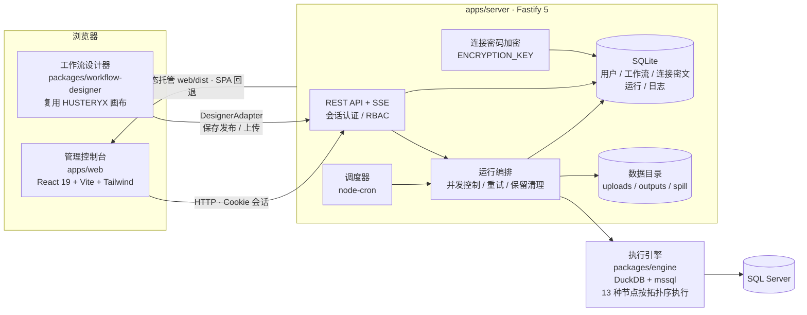

# HUSTServer

HUSTServer 是一个基于 [HUSTERYX](https://github.com/microsoftbi/HUSTERYX) 引擎的**数据集成工作流托管平台**：在工作站用 HUSTERYX 桌面工具设计的 ETL 工作流（`.htyx`）可以上传到服务端统一托管，也可以直接在浏览器里用内置的 **Web 工作流设计器** 从零搭建；平台负责调度执行、运行日志、数据连接与权限管理。

## 功能总览

- 上传 `.htyx` 工作流并绑定数据文件，托管运行
- **Web 工作流设计器**：浏览器内拖拽搭建 / 编辑工作流，保存即发布
- 手动运行 + Cron 调度，节点级状态与实时日志
- SQL Server / MySQL 连接管理（密码加密存储、界面掩码显示）
- 用户与角色（admin / user）、会话认证
- 系统设置（并发数、日志保留期、共享目录、时区）

## 界面一览

### 登录

所有页面均需登录访问；首次启动自动创建初始管理员。


### 控制台首页

登录后进入首页，从左侧导航前往各功能页面。


### 工作流列表

查看全部工作流，支持删除，并可从「上传工作流」「新建画布」两个入口创建。


### 上传工作流与数据绑定

上传 HUSTERYX 导出的 `.htyx` 工作流文件，为输入节点上传 CSV / Excel 数据文件并建立路径映射，使作者本机路径在服务端重新落地。


### 工作流详情与调度

查看工作流信息与运行历史，支持手动立即运行，并可配置 Cron 调度自动执行。


### Web 工作流设计器

内置完整画布设计器（复用 HUSTERYX 前端）：支持 **13 种节点**（CSV / Excel / SQL Server 输入，Select / Filter / Join / Union / Aggregation / Sort 转换，CSV / Excel / SQL Server / Browser 输出），拖拽连线、成环检测与端口约束、节点配置面板编辑；既可从「新建画布」从零搭建，也可从列表 / 详情进入编辑既有工作流，保存即发布到平台。


### 数据连接管理

平台级共享连接库；工作流内 SQL Server 节点的连接可在「数据连接」页按工作流单独维护。连接密码**加密存储**，界面仅显示掩码（`******`），留空表示沿用原值。


### 运行详情与日志

每次运行按拓扑顺序执行各节点，页面展示节点级状态（成功 / 失败 / 行数 / 耗时）与完整执行日志，日志通过 SSE 实时推送。


### 用户管理

管理员可创建用户、重置密码、停用 / 启用账号；普通用户只能访问自己拥有的工作流。


### 系统设置

调整最大并发运行数、日志保留天数、共享目录与时区，数据库配置优先于环境变量默认值。


## 项目结构

```
HUSTServer/
├── apps/
│   ├── server/            # Fastify 5 + better-sqlite3（API、调度、运行编排、静态托管）
│   └── web/               # React 19 + Vite + Tailwind v4 管理控制台
├── packages/
│   ├── engine/            # HUSTERYX 执行引擎移植（DuckDB + mssql，基线 39451d8）
│   └── workflow-designer/ # HUSTERYX 前端画布复用包（基线 836b22a，适配器注入平台能力）
└── docs/                  # 设计文档与截图
```

## 架构

HUSTServer 采用 pnpm monorepo 分层架构，自上而下分为四层：

- **前端层**：`apps/web`（React 19 控制台）负责认证、工作流管理与运行观测；画布编辑能力由独立包 `packages/workflow-designer` 提供——该包逐字节复用 HUSTERYX 前端设计器并裁剪运行态，通过 `DesignerAdapter` 适配器注入平台能力（保存发布、文件上传、结构探测），包内不依赖路由与平台 API。
- **服务层**：`apps/server`（Fastify 5）提供 REST API 与 SSE 实时日志，承担会话认证与工作流级 RBAC、node-cron 调度、运行编排（并发控制、失败重试、日志保留清理）与连接密码加密，生产模式下同时静态托管前端产物（SPA 回退）。
- **执行引擎**：`packages/engine` 是 HUSTERYX 后端引擎的移植（基线 `39451d8`），基于 DuckDB 内存计算与 mssql 驱动，将 13 种节点（CSV / Excel / SQL Server 输入，Select / Filter / Join / Union / Aggregation / Sort 转换，CSV / Excel / SQL Server / Browser 输出）按拓扑顺序执行。
- **存储**：SQLite 单文件承载全部元数据（用户、会话、工作流 payload、连接密文、运行与日志）；上传的数据文件、运行输出与溢出数据落在 `HUSTSERVER_DATA_DIR` 文件目录。



执行链路：调度器或手动触发 → 运行编排从 SQLite 读取工作流 payload → 引擎按拓扑序执行节点（DuckDB 处理数据流，mssql 读写 SQL Server）→ 节点状态与日志回写 SQLite → SSE 实时推送到运行详情页。

### 技术栈

| 层 | 技术 | 用途 |
|---|---|---|
| 前端 | React 19 + TypeScript 5.6 | 管理控制台与设计器 UI |
| | Vite + Tailwind CSS v4 | 构建工具与样式（`@source` 跨包扫描设计器 class） |
| | react-router-dom 7 | 路由与受保护路由（`RequireAuth`） |
| | @xyflow/react 12 + Zustand 5 | 设计器画布渲染与画布状态（成环检测 / 端口约束） |
| | Radix UI（shadcn 风格）+ lucide-react | 设计器原子组件与图标 |
| 服务端 | Node.js ≥ 20 + Fastify 5 | REST API、静态托管、SPA 回退 |
| | better-sqlite3 13 | 单文件元数据存储（同步事务，支撑连接对账） |
| | @fastify/multipart / @fastify/static | 工作流与数据文件上传 / 前端产物托管 |
| | node-cron + cron-parser | Cron 调度触发与下次执行时间计算 |
| | bcryptjs + Cookie 会话 | 密码哈希与登录态（SSE 同源凭据） |
| 执行引擎 | DuckDB（@duckdb/node-api 1.5.6） | 节点间数据流的内存列式计算 |
| | mssql 12 | SQL Server 读取 / 写入 |
| | xlsx 0.18 | Excel 读写 |
| 工程 | pnpm workspace | monorepo（`@hustserver/*` 包约定） |
| | vitest 2 | 单元测试（server / engine / 设计器包） |

## 快速开始

环境要求：Node.js ≥ 20、pnpm。

```bash
pnpm install
pnpm build          # 构建全部包（server / web / engine / workflow-designer）
```

启动服务（需提供会话密钥与 32 字节加密密钥）：

```bash
SESSION_SECRET=please-change-me \
ENCRYPTION_KEY=0123456789abcdef0123456789abcdef0123456789abcdef0123456789abcdef \
BOOTSTRAP_ADMIN_USER=admin \
BOOTSTRAP_ADMIN_PASSWORD=your-password \
node apps/server/dist/index.js
```

访问 `http://127.0.0.1:8787` 即可使用。常用环境变量：

| 变量 | 默认值 | 说明 |
|---|---|---|
| `HUSTSERVER_HOST` / `HUSTSERVER_PORT` | `127.0.0.1` / `8787` | 监听地址与端口 |
| `HUSTSERVER_DATA_DIR` | `~/.hustserver` | 数据目录（SQLite、上传、输出） |
| `SESSION_SECRET` | 必填 | 会话签名密钥 |
| `ENCRYPTION_KEY` | 必填 | 64 位十六进制（32 字节）连接密码加密密钥 |
| `BOOTSTRAP_ADMIN_USER` / `BOOTSTRAP_ADMIN_PASSWORD` | `admin` / 随机生成 | 初始管理员；未设置密码时随机密码仅打印一次到日志 |
| `MAX_CONCURRENT_RUNS` | `2` | 最大并发运行数 |
| `LOG_RETENTION_DAYS` | `90` | 运行日志保留天数 |

开发模式：

```bash
pnpm dev            # 并行启动 server（tsx watch）与 web（vite，/api 代理到 8787）
pnpm test           # 运行全部单元测试
```

## 安全设计

- SQL Server 连接密码使用 `ENCRYPTION_KEY` 加密落库，工作流 payload 中**绝不包含明文连接**
- 设计器载入时连接以掩码回填，保存发布时密码留空表示沿用原值，防止掩码覆盖真实密码
- 全部 API 经会话 Cookie 认证 + 工作流级属主 / 管理员（RBAC）授权
- 保存发布采用事务化连接对账，删除节点后遗留的连接配置同步清理，避免节点 ID 复用时旧配置「复活」

## 相关项目

- [HUSTERYX](https://github.com/microsoftbi/HUSTERYX) —— 本项目的MacOS Desktop Designer。
