# 个人数据工作台用户操作手册

本手册面向个人数据工作台的日常使用者（工作流作者、Job 编排者、仪表板作者与查看者），按「功能模块 → 操作步骤」组织，配有界面截图。若想先了解系统定位与技术架构，请先阅读 [README.md](README.md)。

## 目录

- [1. 登录与界面导航](#1-登录与界面导航)
- [2. 工作流](#2-工作流)
- [3. Job 编排](#3-job-编排)
- [4. 数据模型（加载成模型）](#4-数据模型加载成模型)
- [5. 资源库](#5-资源库)
- [6. 数据连接](#6-数据连接)
- [7. 仪表板](#7-仪表板)
- [8. 用户管理（管理员）](#8-用户管理管理员)
- [9. 系统设置（管理员）](#9-系统设置管理员)
- [10. 附录：权限矩阵与错误提示速查](#10-附录权限矩阵与错误提示速查)

---

## 1. 登录与界面导航

### 1.1 登录

打开系统地址（默认 `http://127.0.0.1:8787`）会进入登录页。输入 `用户名` 与 `密码`，点 `登录`（也可直接回车提交）。

- 成功：跳转到「工作流」列表页。
- 失败：页面提示 `用户名或密码错误`。

首次部署时系统会自动创建初始管理员（见 README 的 `BOOTSTRAP_ADMIN_USER` / `BOOTSTRAP_ADMIN_PASSWORD`）。若以已登录状态访问登录页，会自动跳转到工作流列表。

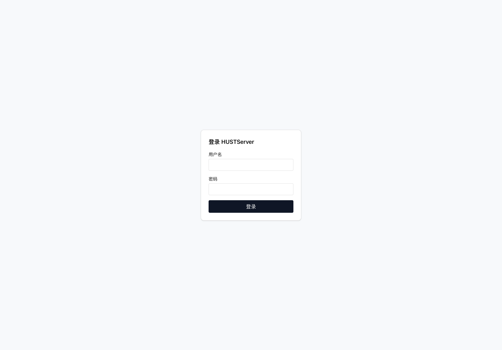

### 1.2 顶部导航与权限

登录后顶部是全局导航，从左到右依次为 `主页`（仅管理员可见）、`工作流`、`仪表板`、`数据模型`、`资源管理`、`连接`、`Job编排`、`Job日志`、`用户`、`设置`；右侧显示当前账号 `用户名（角色）` 与 `退出` 按钮。

**导航项按你的权限动态渲染**——没有对应能力的入口不会出现；即使手动输入未授权路由，页面也只会显示 `无权访问。`

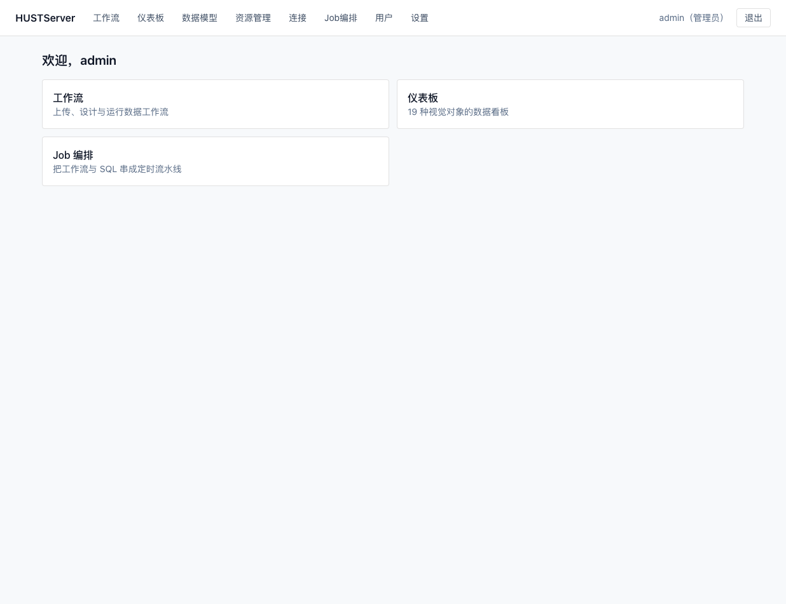

### 1.3 主页看板（管理员）

点顶部导航最左的 `主页` 进入（仅管理员）。页面自上而下分两部分：

- **数量卡片**：`工作流`、`仪表板`、`数据模型`、`连接`、`Job`、`用户` 六张卡片显示当前数量，点击卡片跳转到对应列表页。
- **新建趋势**：六张折线图，横轴为日期、竖轴为每天新增的数量；右上角可切换 `最近 7 天` / `最近 30 天` / `最近 90 天`。

### 1.4 退出

点右上角 `退出` 即注销并返回登录页。

---

## 2. 工作流

工作流是 HUSTERYX 的节点画布（`.htyx`），平台负责托管、调度与运行。进入方式：顶部导航 `工作流`。

### 2.1 工作流列表

列表展示全部可见工作流，表头为 `名称`、`更新时间`、`操作`。

- `上传工作流`：上传 HUSTERYX 导出的文件并配置输入绑定。
- `新建画布`：在内置 Web 设计器中从零搭建。
- 行内操作：点名称进入详情、`数据连接` 配置该工作流的 SQL Server 节点连接、`编辑画布` 打开设计器、`删除` 移除工作流。

删除会弹出确认：`确定删除工作流「<名称>」？其运行记录将一并删除。`

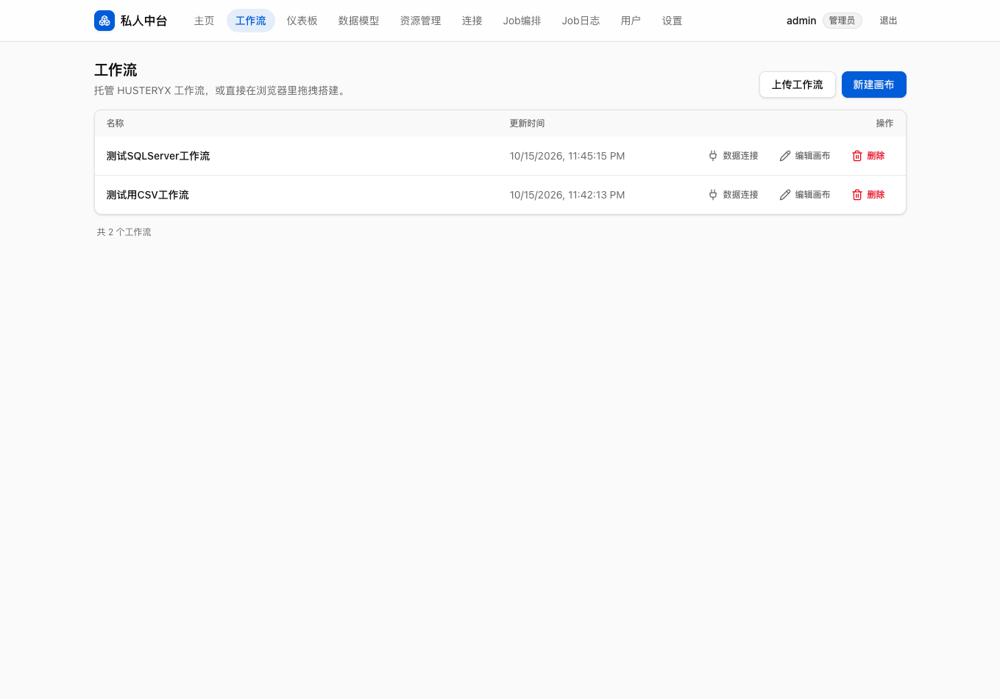

### 2.2 上传工作流并绑定数据

1. 点 `上传工作流`，选择文件（支持 `.htyx` / `.json`）。页面提示：`选择 HUSTERYX 导出的工作流文件（.htyx / .json）。`
2. 解析后进入 `配置输入绑定` 页面，可修改 `工作流名称`。
3. 对每个**输入节点**选择一种数据来源（四选一）：
   - `上传数据文件`：直接上传 CSV / Excel。
   - `服务端路径`：填写服务器上的绝对路径（占位符提示 `/absolute/path/data.csv`）。
   - `连接`：从已配置的数据连接中选（占位 `请选择连接…`）。
   - `资源库文件`：从平台资源库中选（占位 `请选择资源库文件…`）。
4. `输出` 分区列出工作流输出节点，运行结果会写入服务端输出目录。
5. 点 `创建工作流` 提交；选择了「上传数据文件」的输入会连同文件一并上传。成功后跳转到该工作流详情页。

校验提示：
- `输入「<节点名>」选择了上传数据文件，但未选择文件。`
- `输入「<节点名>」选择了资源库文件，但未选择具体文件。`

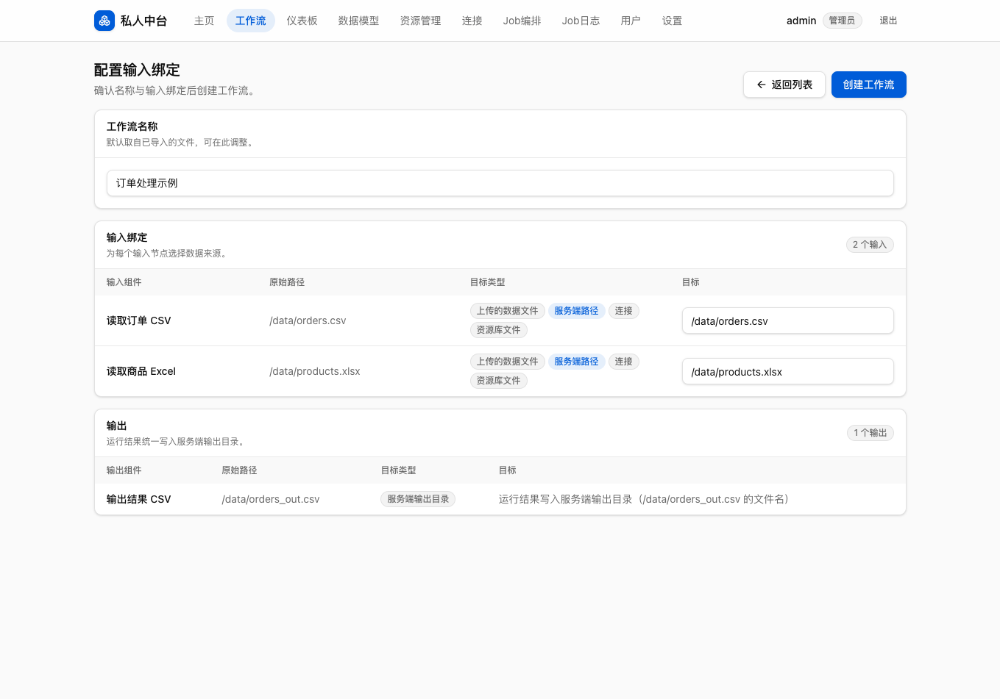

### 2.3 用 Web 工作流设计器搭建

从列表的 `新建画布`（或详情页/列表的 `编辑画布`）进入设计器。设计器支持 **13 种节点**：CSV / Excel / SQL Server 输入，Select / Filter / Join / Union / Aggregation / Sort 转换，CSV / Excel / SQL Server / Browser 输出；支持拖拽连线、成环检测与端口约束、节点配置面板编辑。

- 新建画布：默认名 `未命名工作流`。
- **保存即发布**：点设计器内的保存按钮把画布写回平台；新建时首次保存后地址栏会变为编辑态路由。
- 保存时连接密码字段中的掩码哨兵会被清洗，不会把 `******` 写回配置。

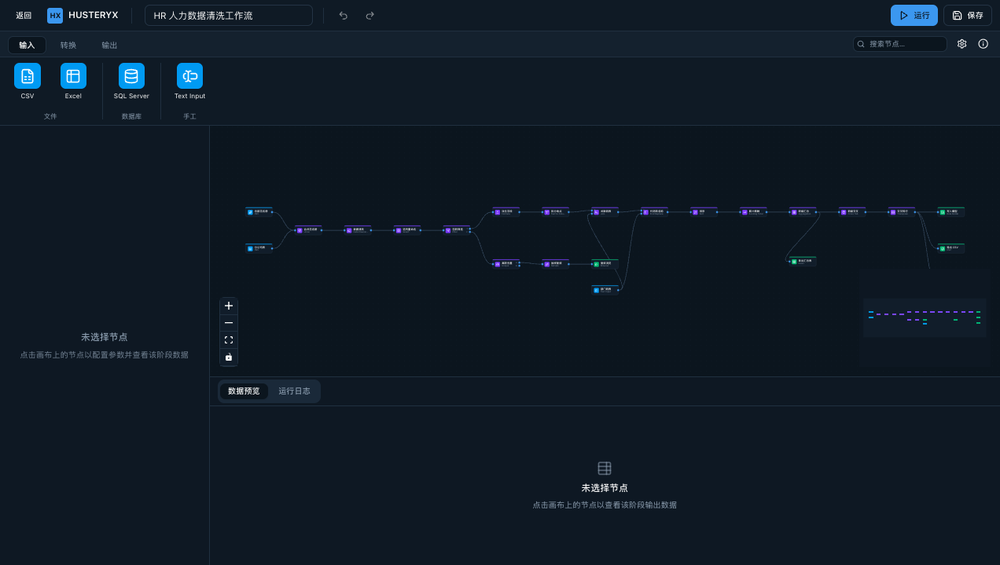

### 2.4 工作流详情与调度

详情页分为 `输入绑定`、`输出`、`运行历史` 三个分区。页面顶部左侧有 `返回列表`，与右侧的 `编辑画布` 并排。

- `返回列表`：回到工作流列表页。
- `编辑画布`：打开设计器。
- `立即运行`：提交一次运行，成功后跳转到该次运行的 `运行详情` 页。
- `输入绑定`：展示每个输入的落地方式与目标（`上传的数据文件` / `服务端路径` / `连接` / `资源库文件`），上传类输入可在此 `重新上传数据文件：`。
- `运行历史`：表头 `时间`、`触发`、`状态`、`耗时`、`详情`，`详情` 列点 `查看日志` 进入运行详情。状态含义：`排队中` / `运行中` / `成功` / `失败` / `已取消` / `已跳过`。

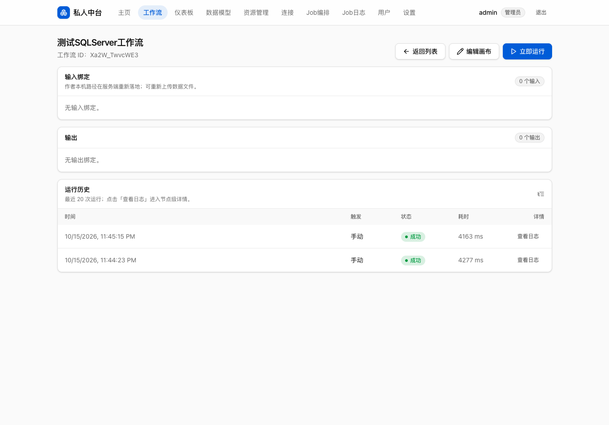

### 2.5 工作流数据连接

在工作流列表或详情点击 `数据连接` 进入。页面说明：`仅可配置该工作流内的 SQL Server 输入/输出节点连接。未修改的节点默认使用工作流文件中的配置。`

- 表格列：`节点`、`类型`、`服务器`、`库`、`操作`。
- 点行内 `编辑` 展开表单：`服务器`（必填）、`端口`（默认 `1433`）、`用户`、`密码`（占位符 `留空则不修改`）、`数据库`。
- `测试连接`：成功提示 `连接可达`，失败提示 `连接不可达：<原因>`。
- `保存修改`：提交后弹出 `保存成功`。
- 若工作流内没有 SQL Server 节点，显示 `该工作流没有可配置的 SQL Server 节点。`

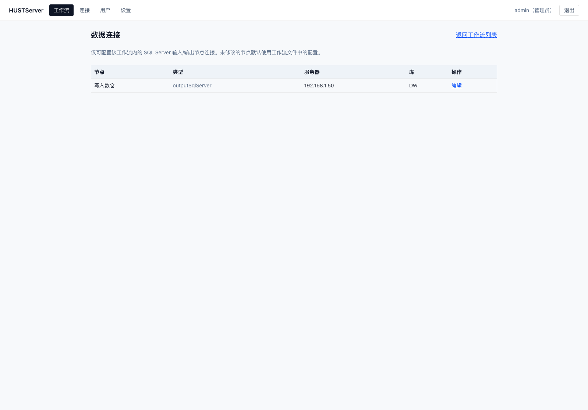

### 2.6 运行详情与实时日志

进入运行详情后，页面分为 `节点结果` 与 `日志` 两个分区。

- `节点结果` 表头：`节点`、`类型`、`状态`、`行数`、`耗时`、`错误`——按拓扑顺序逐节点展示执行结果。
- `日志` 通过 SSE 实时推送，运行中页面右上显示 `实时` 徽标，结束后自动停止；日志行格式为 `[时间] 级别 节点 消息`。

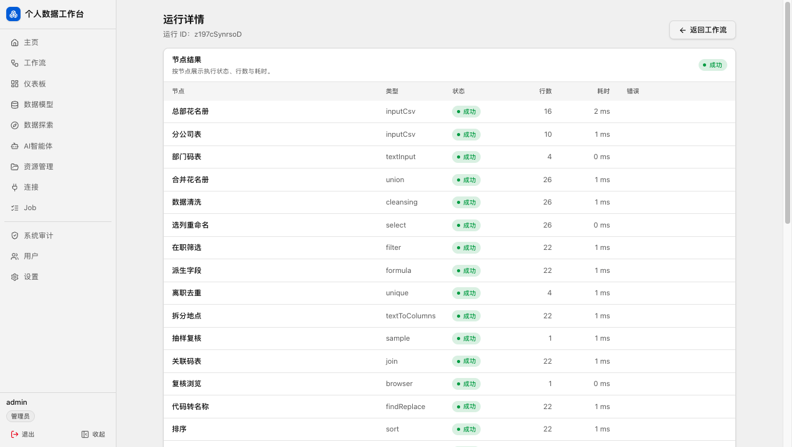

---

## 3. Job 编排

工作流是「一张画布」，Job 是更高一层的**编排容器**：把若干工作流、SQL 语句与数据模型加载串成一条有序流水线，可手动或按 Cron 自动执行。进入方式：顶部导航 `Job编排`。

### 3.1 Job 列表

表头：`名称`、`步骤数`、`调度`、`最近运行`、`更新时间`、`操作`。

- 右上 `新建 Job` 进入编辑页。
- 调度列：未启用时显示 `未启用`；启用后显示人类可读的频次（如 `每天 08:00（Asia/Shanghai）`）。
- 最近运行列：显示最近一次运行的状态（可点入 `Job 运行详情`），从未运行时显示 `从未运行`。
- 行内操作：`运行`（立即执行一次并跳转到运行详情）、`编辑`、`删除`（确认文案：`确定删除 Job「<名称>」？其运行历史将一并删除。`）。

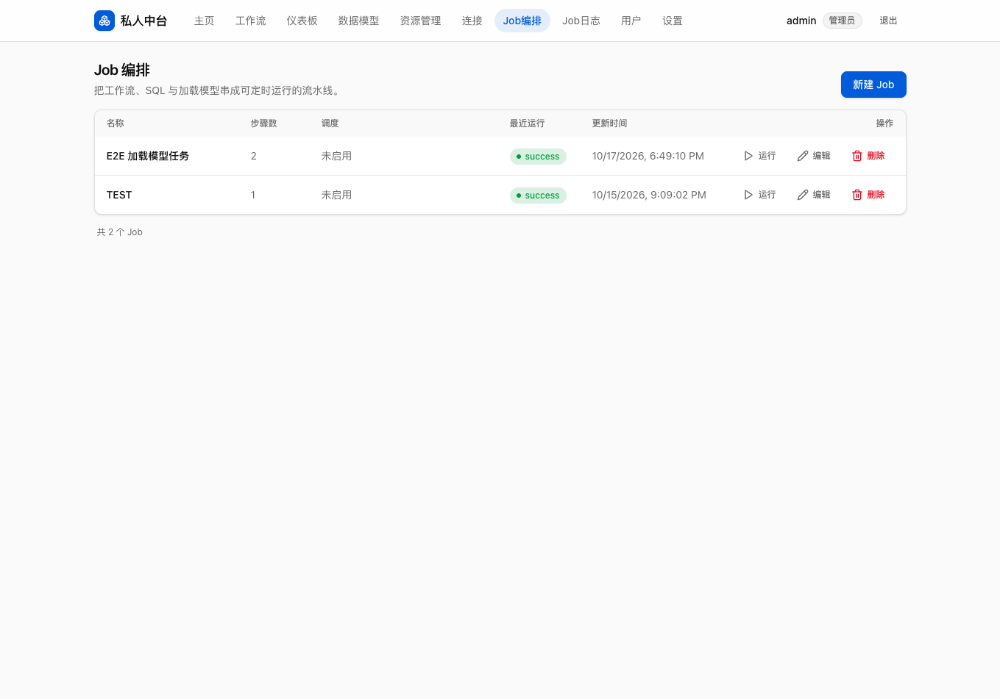

### 3.2 新建 / 编辑 Job

编辑页分为四个分区：`基本信息`、`步骤编排`、`调度配置`、`保存/手动运行`，编辑已有 Job 时底部还会显示 `最近运行（10 条）`。

**基本信息**：`名称（必填）`、`描述`。

**步骤编排**：点 `+ 添加步骤` 打开步骤弹窗（见 3.3）。已添加的步骤以卡片展示，包含序号、类型徽标（`工作流` / `SQL` / `模型`）、步骤名、内容摘要与 `失败策略：<中止|继续>`；卡片右侧可 `上移` / `下移` / `编辑` / `删除`。无步骤时显示 `暂无步骤，请点击下方按钮添加。`

**调度配置**：勾选 `启用定时调度` 后可设置 `频次`（`每天` / `每周` / `每月` / `自定义 cron`）、`时间`（每周/每月时另需 `星期` 或 `日期（1-31）`）、`cron 表达式（5 段）`（自定义时）、`时区`。默认 `每天 08:00`、时区 `Asia/Shanghai`。

**保存与运行**：点 `保存`（新建时提交后跳转到编辑态路由），保存成功后弹出 `保存成功`；编辑已有 Job 时可点 `手动运行` 立即执行一次。保存级校验会逐条提示，例如 `请填写 Job 名称`、`至少需要一个步骤`、`步骤 2：请选择连接`。

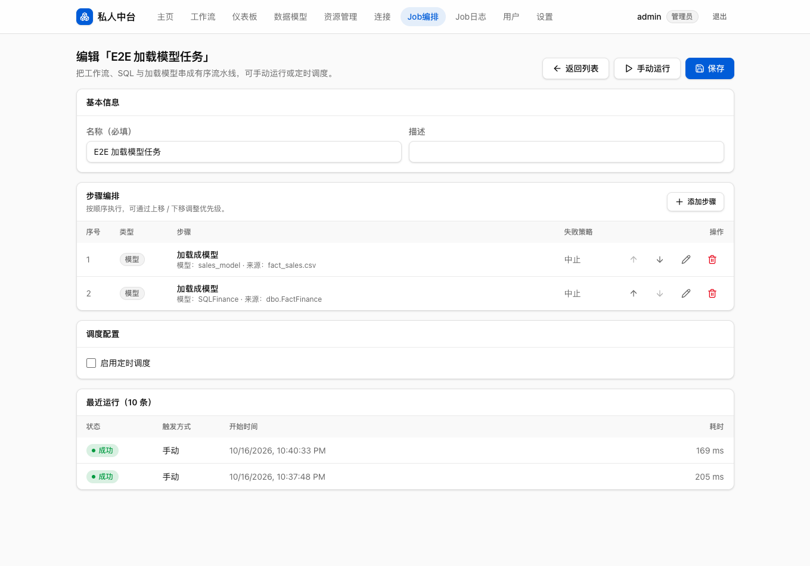

### 3.3 添加步骤：三种类型

点 `+ 添加步骤`（或步骤卡片的 `编辑`）打开步骤弹窗，顶部用分段控件切换三种步骤类型：`运行工作流`、`运行 SQL`、`加载成模型`。切换类型时，若步骤名仍是默认名（`运行工作流` / `运行 SQL` / `加载成模型`），会自动同步为新类型的默认名；自定义名不会被覆盖。

**① 运行工作流**：选择 `工作流`（下拉 `请选择…`）。执行该工作流的完整节点链路。

**② 运行 SQL**：选择 `连接（SQL Server）`，并在 `SQL（将直接在该连接上执行）` 文本框中填写语句。

**③ 加载成模型**（详见第 4 章）：
- `数据来源`：`资源库文件（CSV/Excel）` 或 `SQL Server 表`。
  - 选「资源库文件」时：`资源文件` 下拉从资源库中挑选 CSV / Excel。
  - 选「SQL Server 表」时：先选 `连接（SQL Server）`，再在 `数据表` 下拉选择表（显示 `schema.表名`）。
- `模型名（字母或下划线开头，仅含字母数字下划线，最长 64）`：为该数据模型取的名字，后续在仪表板中直接按此名使用。

**失败策略**（三种类型通用）：
- `中止（后续步骤跳过）`：本步失败即终止整个 Job，后续步骤标记为跳过。
- `继续（记录失败并执行下一步）`：记录失败但继续执行后续步骤。

点 `添加`（编辑时为 `保存`）写入步骤；点 `取消` 或按 `Esc` 关闭。弹窗内校验提示如 `请选择工作流`、`请选择连接`、`请填写 SQL`、`请填写模型名`、`请选择资源文件`、`请选择数据表`。

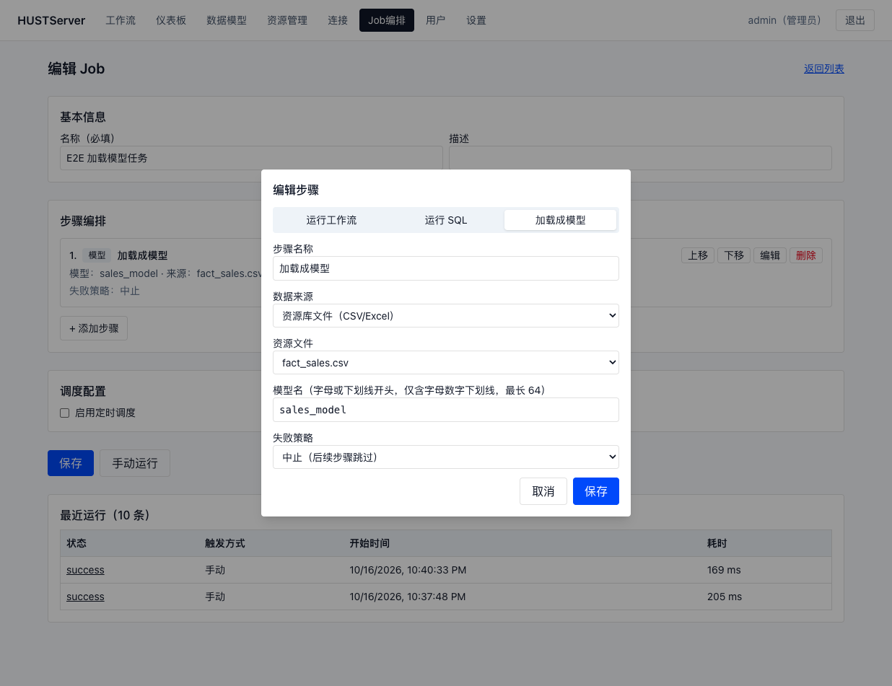

### 3.4 运行 Job 与运行详情

在 Job 列表点 `运行`，或在编辑页点 `手动运行`，即可立即执行一次。

Job 运行详情页顶部显示 `状态`、`触发方式`（`手动` / `调度`）、`开始时间`、`耗时`；下方表格按顺序展示每个步骤：`顺序`、`步骤`、`类型`、`状态`、`耗时`、`结果`、`错误`。若某个步骤是「运行工作流」，`结果` 列会提供 `查看运行详情` 链接跳到该工作流的运行详情；SQL 类步骤会显示 `影响 N 行`。

运行进行中（`排队中` / `运行中`）页面会自动轮询刷新，直到结束。

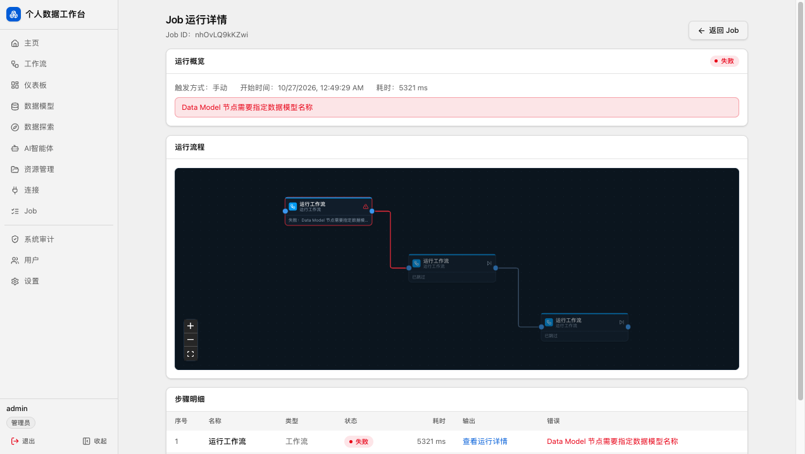

### 3.5 Job 日志

顶部导航 `Job日志` 进入。这里汇总**全部 Job 的最近一次运行**，用于快速判断「谁跑过、跑成没跑成、跑了多久」。

表头：`Job 名称`、`调度配置`、`运行时间`、`运行结果`、`触发方式`、`耗时`。

- 按最近运行时间**倒序**排列；从未运行过的 Job 也会列出（运行时间显示 `—`、运行结果显示 `未运行`）。
- `Job 名称` 可点击，进入该 Job 的编辑页。
- `调度配置` 显示人类可读的频次，未启用时显示 `未启用`。
- `运行结果` 是状态徽标，点击进入对应的 `Job 运行详情`。
- `触发方式` 为 `手动` 或 `定时`；`耗时` 为该次运行的毫秒数。
- 右上角 `刷新` 重新拉取；页面底部显示 `共 N 个 Job`。

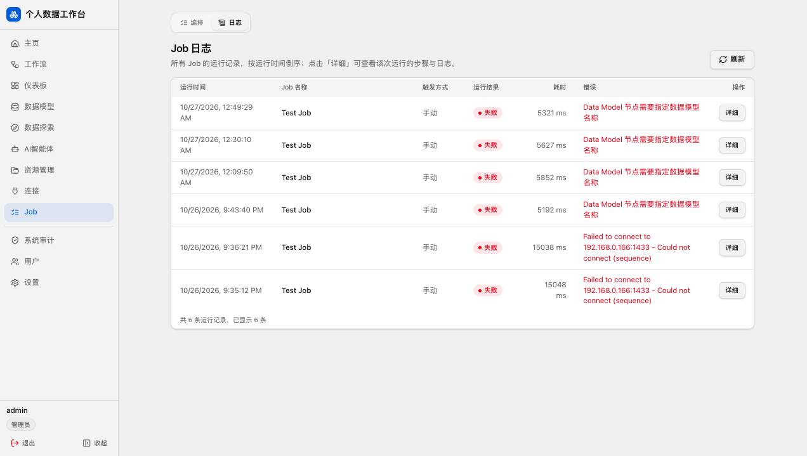

---

## 4. 数据模型（加载成模型）

### 4.1 概念

「数据模型」是把外部数据**物化**到平台内部的结果：在 Job 中用「加载成模型」步骤，把资源库里的 CSV / Excel 文件，或 SQL Server 的表/查询，加载进平台内的持久 DuckDB 文件，并取一个**模型名**。之后仪表板就能直接以这个名字把模型当作数据集使用。

### 4.2 加载一个数据模型

1. 顶部导航进入 `Job编排` → `新建 Job`（或编辑已有 Job）。
2. 在 `步骤编排` 点 `+ 添加步骤`，选择 `加载成模型`。
3. 选择数据来源并指定资源文件或数据表，填写 `模型名`，设置失败策略，点 `添加`。
4. `保存` Job，然后 `手动运行`（或等调度触发）。
5. 运行成功后，该模型即可在 `数据模型` 页与仪表板中看到。

> 重复对同一模型名执行加载会**覆盖**该模型（见 4.4）。

### 4.3 管理数据模型

顶部导航 `数据模型` 进入模型列表，表头：`模型名`、`来源`、`行数`、`列数`、`加载时间`、`操作`。

- `来源` 形如 `CSV 文件：fact_sales.csv` 或 SQL Server 来源。
- `刷新` 重新拉取列表。
- 右上角 `新建模型`（需 `Job 编排` 能力）：打开弹窗直接载入一个新模型，等价于 Job 里的「加载成模型」步骤——填写 `模型名`，选择 `数据来源`（`资源库文件（CSV / Excel）` 或 `SQL Server 表`）后点 `载入`。载入在服务端同步执行，数据量大时弹窗会一直显示 `载入中…`；同名模型会先确认再覆盖，成功后列表顶部提示 `已载入模型「<名称>」（N 行）`。
- `数据预览`：弹出子窗体读取该模型的**前 1000 行**，顶部标注 `N 列 · 显示 M 行`。
- `透视`：弹出大窗体做拖拽式透视——右侧是 `字段` 列表，最右侧从上到下是 `X 轴（列）`、`Y 轴（行）`、`数值`、`筛选列` 四个区域；把字段拖入（或点击字段加入 `数值`）即可生成透视表。聚合在后端下推 DuckDB 执行，配置变化后自动刷新，顶部显示 `已聚合全量 N 行`；结果过大时会提示 `结果已截断`，可点 `重新加载`。
- `统计`：弹出子窗体，**一列一行**展示列统计——第一列是列名与类型，第二列是该列的统计胶囊：`非空`、`空值`、`不重复`；数值列另显示 `最小`、`最大`、`平均`、`中位数`、`标准差`。全表扫描，列多或数据量大时较慢。
- `重命名`：输入新模型名并确认；改名会同步 DuckDB 中的物理表名，完成后提示 `已重命名为「<新名>」。注意：已引用旧名「<旧名>」的仪表板将失效。`
- `删除`：确认后移除模型（元数据与 DuckDB 表一并删除）。

修改模型（新建 / 重命名 / 删除）需要 `Job 编排` 能力；仅查看、预览、透视与统计需要 `仪表板查看` 能力。

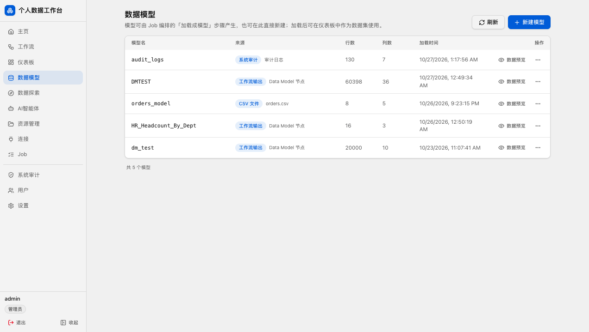

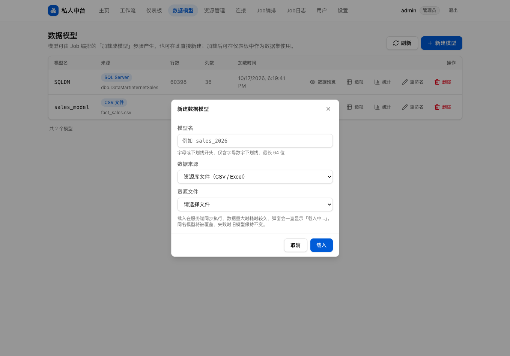

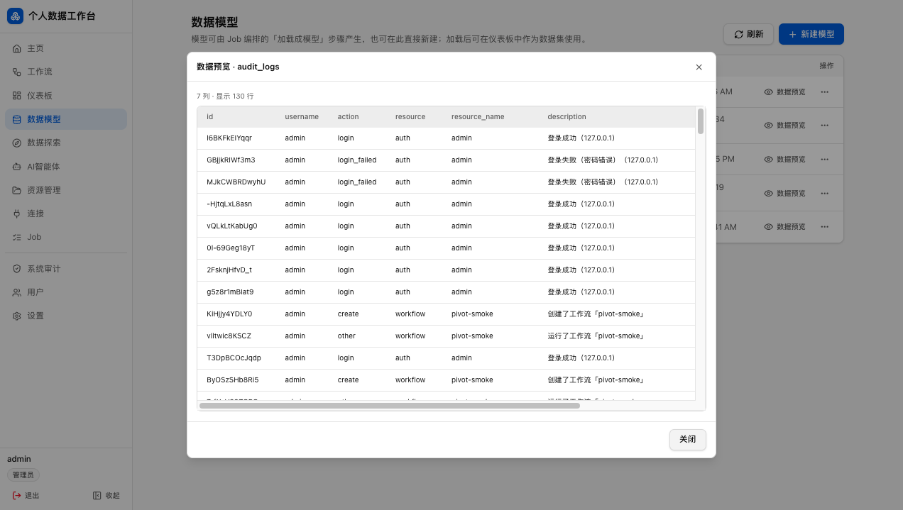

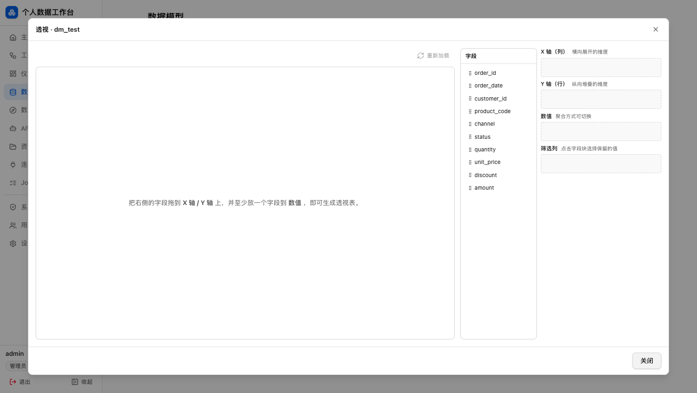

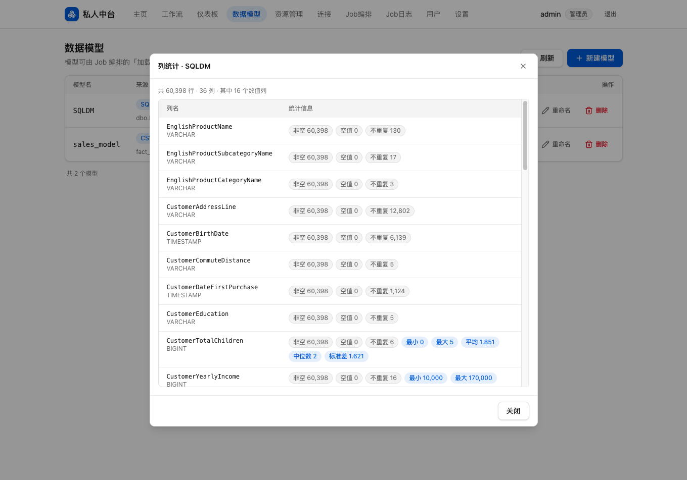

### 4.4 覆盖语义与注意事项

- 加载采用「先写入 staging 临时表 → 成功后原子替换目标表」的方式：**任一步失败，旧模型保持不变**，不会出现半新半旧。
- 同一模型名重复加载 = 覆盖，行数与加载时间都会刷新。
- 若仪表板引用的模型被改名或删除，打开仪表板时会在顶部提示 `数据集「<名称>」不可用：<原因>`，并提供 `重试`；其余图表不受影响。

---

## 5. 资源库

顶部导航 `资源管理` 进入。资源库是平台内的文件工作区，用于存放工作流输入与「加载成模型」所需的 CSV / Excel 文件。

### 5.1 浏览与多选

- 左侧为目录树（根节点 `根目录`），右侧为当前目录内容；顶部有 `新建文件夹` 与 `上传 csv / excel` 按钮，右上可切换 `图标` / `列表` 视图。
- 多选：`Cmd/Ctrl+单击` 加选/取消，`Shift+单击` 区间选择；有选中时标题旁显示 `；已选 N 项`。
- 双击文件夹进入、双击文件下载；在条目上右键可 `打开` / `下载`、`重命名`、`删除`（可批量 `删除选中的 N 项`）。

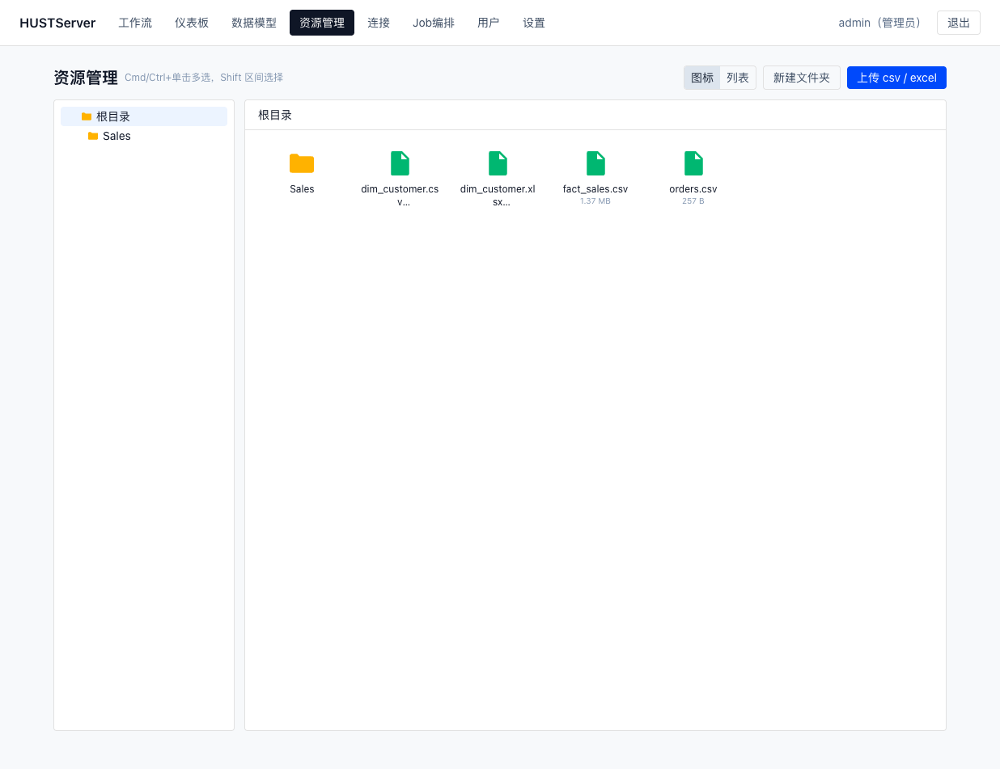

### 5.2 常用操作

- **新建文件夹**：点 `新建文件夹`，输入名称（占位符 `文件夹名称（可用 / 创建多级目录）`）后点 `创建`。
- **上传**：点 `上传 csv / excel` 选择文件上传（接受 `.csv` / `.xlsx` / `.xls`）。
- **重命名**：右键条目 → `重命名`，回车提交、`Esc` 取消。
- **移动**：直接把条目**拖拽**到左侧目录树、面包屑或内容区背景即可移动。
- **删除**：确认文案为 `确定删除文件「<名称>」？` 或 `确定删除文件夹（含其下全部内容）「<名称>」？`；多选时为 `确定删除选中的 N 项？（含文件夹及其全部内容）`。

---

## 6. 数据连接

顶部导航 `连接` 进入。这里维护**平台级共享连接库**（SQL Server）；工作流内 SQL Server 节点的连接则按工作流单独维护（见 2.5）。

### 6.1 连接列表

表头：`名称`、`类型`、`服务器`、`库`、`共享`、`操作`。行内操作：`测试`（弹出可达性结果）、`编辑`、`删除`（确认文案 `确认删除连接「<名称>」？`）。

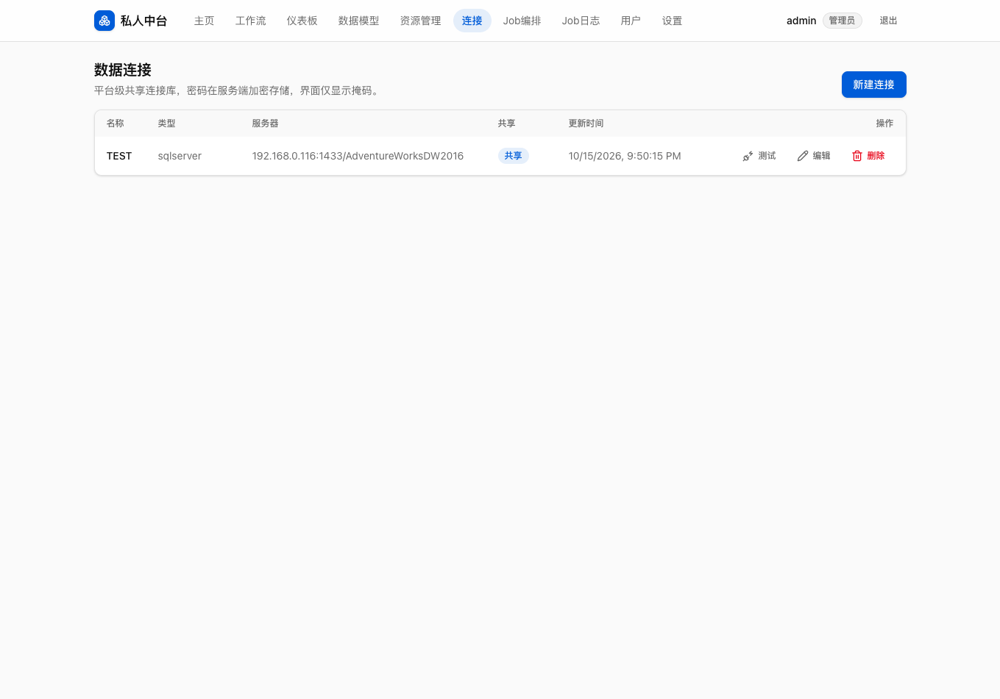

### 6.2 新建 / 编辑连接

点 `新建连接` 打开弹窗（字段）：

- `名称`（必填）、`服务器`（必填）、`端口`（默认 `1433`）、`用户`、`密码`、`数据库`、`共享给所有用户`。

关于密码：**连接密码加密存储**，界面只显示掩码；编辑时 `密码` 输入框占位符为 `留空则不修改`——**留空即沿用原密码**。

- `测试连接`：成功提示 `连接可达，已读取 N 个数据库`，并把 `数据库` 下拉填充为实际库列表；失败提示 `连接不可达：<原因>`。`数据库` 下拉需要先测试成功才可选。
- 提交按钮：新建时为 `新增`，编辑时为 `保存修改`，提交成功后弹出 `保存成功`；另有 `取消`。

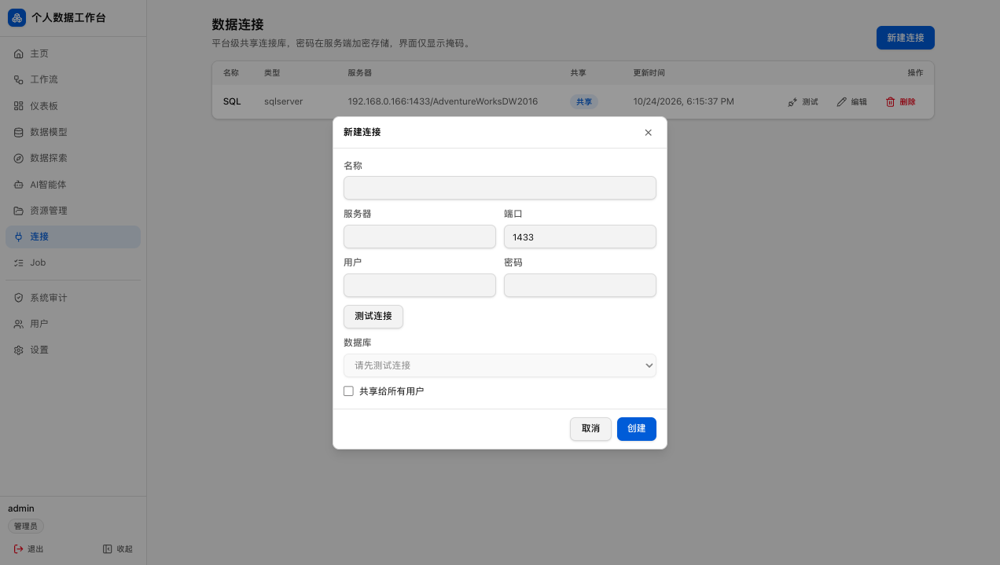

---

## 7. 仪表板

顶部导航 `仪表板` 进入。仪表板用于把数据做成可视化报表。

### 7.1 仪表板列表

表头：`名称`、`更新时间`、`操作`。

- `新建仪表板`：输入名称（占位符 `仪表板名称`）后 `创建`，成功后进入编辑器。
- 点击**名称**以预览方式打开仪表板（只读）。
- 行内操作：`编辑`（进入编辑器）、`重命名`、`删除`（确认文案 `确定删除仪表板「<名称>」？`）。
- 仪表板对所有具备 `仪表板查看` 能力的用户可见，没有单独的共享开关。

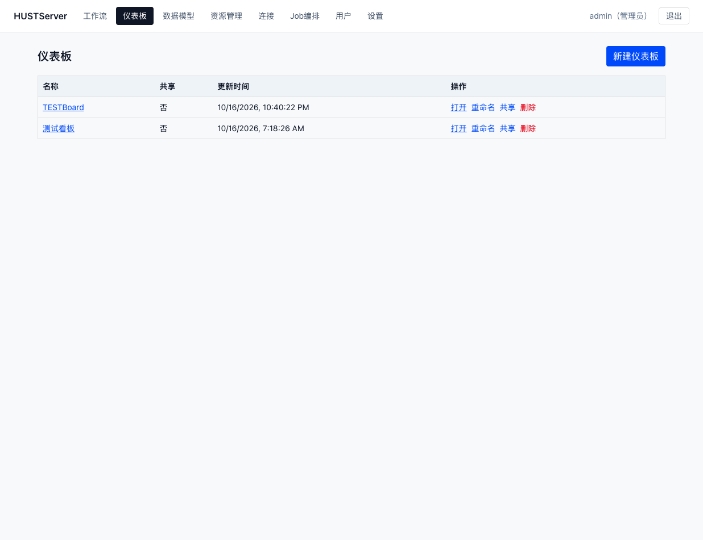

### 7.2 编辑器概览

编辑器顶部是 `← 返回列表`、仪表板名与 `保存` 按钮；左侧竖排导航在 `仪表板`（画布与图表）与 `数据`（数据集管理）两个视图间切换；右侧为 `可视化`（图表类型与字段井）与 `数据`（字段列表）两栏。

- `保存`：把当前定义写回平台；也可按 `Ctrl/Cmd+S`。成功后右上显示 `已保存于 <时间>` 并弹出 `保存成功`。
- 只有具备 `仪表板编辑` 能力时才会显示保存按钮。

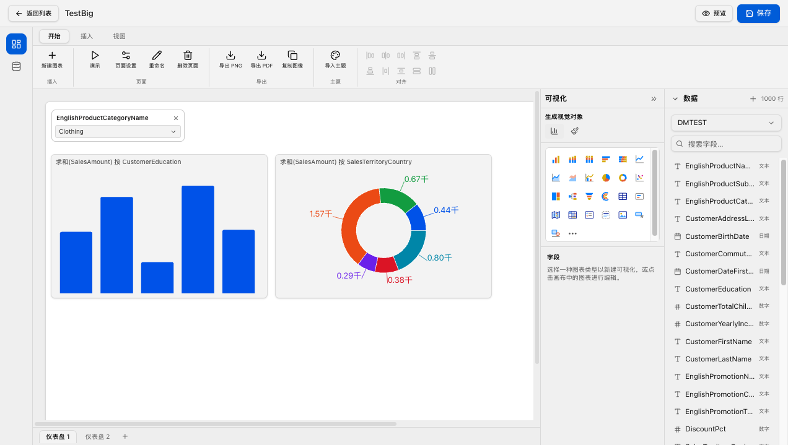

### 7.3 添加数据集（三种来源）

在 `数据` 视图点 `+`（`添加数据集`），从下拉中选择一种来源：

- `从资源库文件（CSV/Excel）`：选 `资源文件`。
- `从连接的数据库表`：先选 `连接`，再选 `数据表`（显示 `schema.表名`，视图会标注 `（视图）`）。
- `从数据模型（DuckDB）`：选 `数据模型`（选项形如 `sales_model（20000 行 · 10 列）`）。

选定后点 `载入`，右侧出现数据预览与 `数据集名称` 输入框，点 `存为数据集` 保存（提示 `已添加数据集「<名称>」`）。数据集列表项带有来源徽标：`CSV` / `Excel` / `SQL` / `模型`。

> 仪表板只保存**数据集定义**，行数据在打开页面时按定义重新取数。若某个来源暂时不可用（例如模型被删除），顶部会出现 `数据集「<名称>」不可用：<原因>` 与 `重试` 按钮。

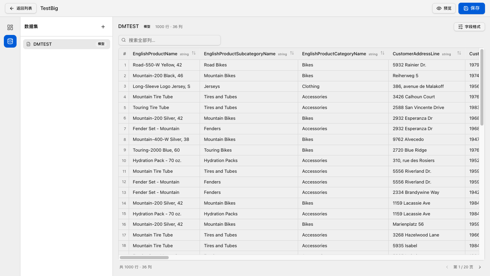

### 7.4 新建图表与使用字段

- 点右侧 `可视化` 栏中的图表图标，或画布上的 `新建图表`，即可创建视觉对象；内置 20 种视觉对象：`簇状柱形图`、`堆积柱形图`、`100% 堆积柱形图`、`条形图`、`堆积条形图`、`折线图`、`面积图`、`堆积面积图`、`折线与柱形图`、`饼图`、`环形图`、`散点图`、`树状图`、`分解树`、`漏斗图`、`径向条形图`、`表格`、`数值卡`、`填充地图`、`数据透视表`。
- 把右侧 `数据` 栏的字段**拖入**字段井，或直接**点击**字段快速添加：
  - 数值字段默认作为度量（按 `求和`），文本/日期字段优先作为维度、其次作为图例。
  - 字段井名称随图表类型变化（如柱形/折线类为 `X 轴` / `图例（可选）` / `Y 轴`；饼图为 `图例` / `详细级别（可选）` / `值`；数据透视表为 `行` / `列` / `值`）。
  - 度量的聚合方式可切换：`求和`、`计数`、`平均`、`最小`、`最大`、`原始值`。
- 图表标题留空时自动生成，规则为「度量 按 维度」（例如 `求和(quantity) 按 order_id`）。
- `树状图` 采用 Power BI 风格的 Squarified 布局：图块面积与值成正比，字段井为 `类别` / `详细级别（可选）` / `值`；拖入 `详细级别` 后按「类别 → 明细」两层分组并显示图例。悬停图块可查看类别、值与占比，点击图块可交叉筛选本页其它图表；`设置视觉对象格式` 中可切换配色方式（按类别 / 按值渐变 / 单色）、分组间距、边框与数据标签。
- `分解树` 采用 Power BI 风格的列式逐层拆分：字段井为 `分析`（度量）与 `说明依据`（可拖入多个维度）。点击节点右侧的 `+`，选择按某个维度拆分，或使用 `高值` / `低值` 自动找出贡献最高 / 最低的类别；点击 `−` 折叠该节点。节点数据条长度按根节点合计归一化，列顶显示当前拆分字段，父节点与子节点之间以肘形连接线相连。展开状态随视觉对象保存；`设置视觉对象格式` 中可调整数据条颜色、每级最大节点数、级别标题、连接线、AI 拆分与数据标签。
- 左上角 `重命名` 可为当前仪表盘页改名；`新建图表` 在尚无数据集时不可用，此时提示 `请先在左侧「数据」标签中添加数据集`。

---

## 8. 用户管理（管理员）

顶部导航 `用户` 进入（需 `管理员` 能力）。

- 表头：`用户名`、`角色`、`状态`、`操作`。一个用户可拥有多个角色，`角色` 列以 `、` 连接（例如 `仪表板用户、工作流作者`）。
- `新建用户`：弹窗填写 `用户名`、`初始密码`、`确认密码`，并勾选一个或多个 `角色`（`管理员` / `工作流作者` / `仪表板作者` / `仪表板用户`）。
  - 校验提示：两次密码不一致时 `两次输入的密码不一致`；未选角色时 `至少选择一个角色`。
- 行内操作：`查看登录日志`、`禁用` / `启用` 切换账号状态（状态列显示 `正常` / `已禁用`）、`重置密码`（弹窗输入新密码，成功后提示 `密码已重置`）、`删除`（确认文案 `确认删除用户「<用户名>」？`）。
- `查看登录日志`：弹出子窗体显示该账号**最近的登录记录**（最多 20 条），四列——`时间`、`结果`（成功 / 失败，失败时在下方标注原因：`用户不存在` / `账号已禁用` / `密码错误`）、`IP`、`客户端`（浏览器的 User-Agent）。日志从功能上线后开始记录，此前的登录无法追溯。

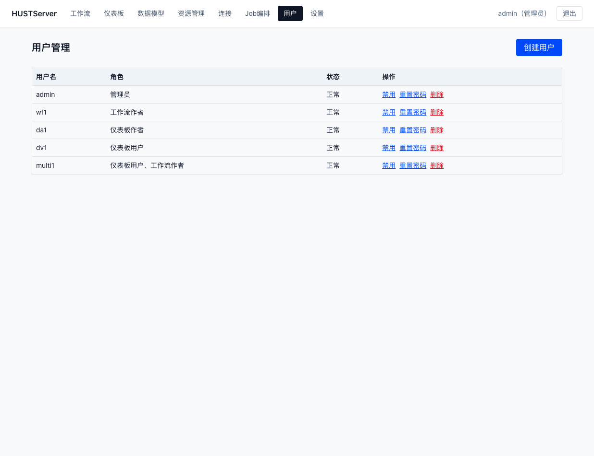

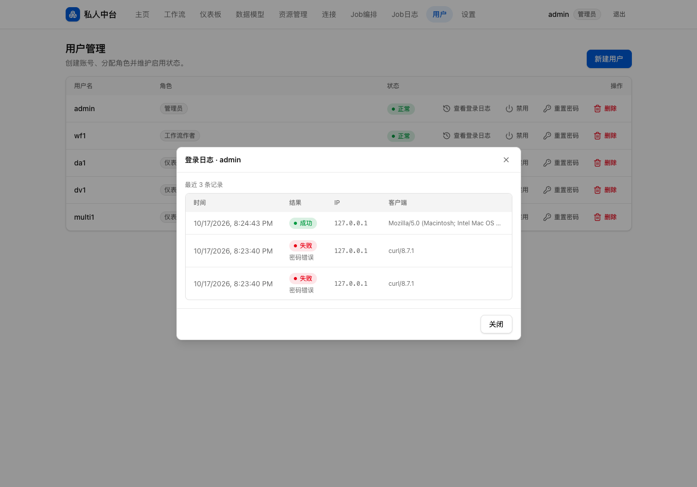

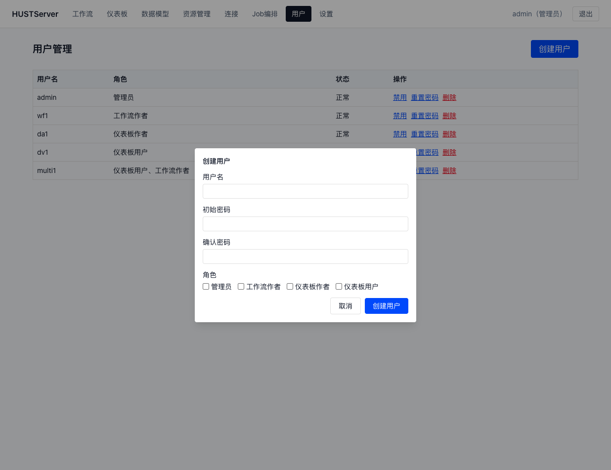

---

## 9. 系统设置（管理员）

顶部导航 `设置` 进入（需 `管理员` 能力）。可调整：

- `最大并发运行数`
- `日志保留天数`
- `共享目录（每行一个，允许服务端路径输入引用）`
- `默认时区`

点 `保存设置` 提交，成功后提示 `保存成功。并发数与保留期在服务重启后完全生效。`

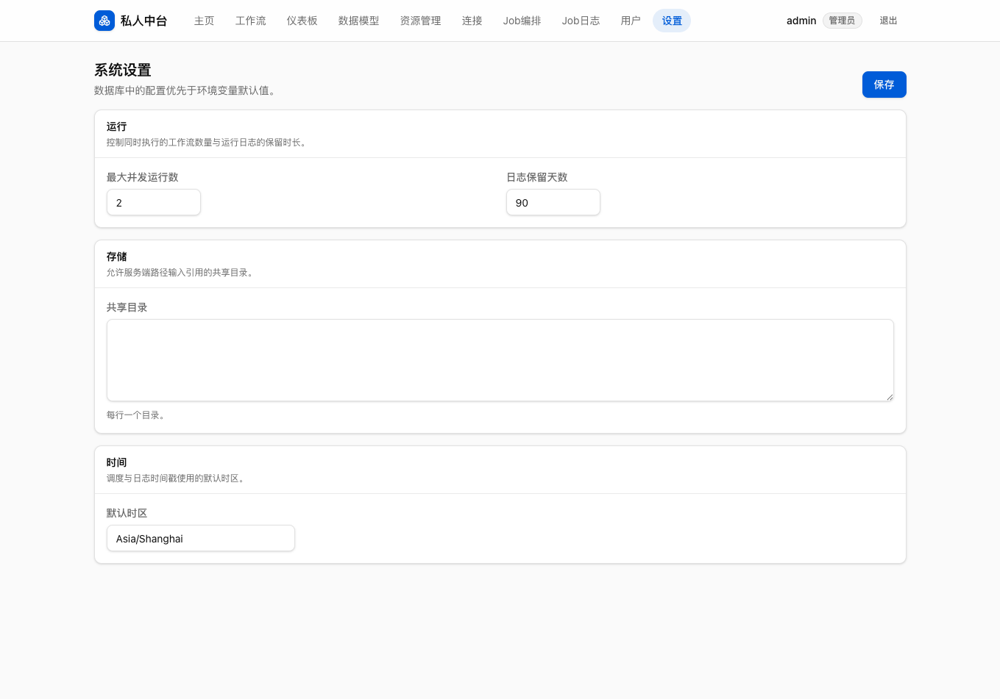

---

## 10. 附录：权限矩阵与错误提示速查

### 10.1 角色与能力

系统采用**四角色 + 八能力**模型：一个用户可拥有多个角色，能力取并集；导航、页面与按钮都按能力渲染，后端同名守卫独立校验。

| 角色 | 具备的能力 |
|---|---|
| `管理员` admin | 全部 8 项 |
| `工作流作者` workflow_author | `workflow`、`job`、`resources`、`connection.manage`、`connection.use` |
| `仪表板作者` dashboard_author | `connection.use`、`dashboard.edit`、`dashboard.view` |
| `仪表板用户` dashboard_viewer | `dashboard.view` |

八项能力与对应入口：

| 能力 | 中文标签 | 覆盖的页面 / 操作 |
|---|---|---|
| `admin` | 管理员 | `主页`、`用户`、`设置`；用户的 `查看登录日志` |
| `workflow` | 工作流 | `工作流` 列表 / 上传 / 详情 / 设计器 / 工作流数据连接 |
| `job` | Job 编排 | `Job编排`、`Job日志`、`运行详情`、`Job 运行详情`；数据模型的 `新建模型` / `重命名` / `删除` |
| `resources` | 资源管理 | `资源管理` |
| `connection.manage` | 连接管理 | `连接` 页面（平台共享连接库） |
| `connection.use` | 连接使用 | 在设计器/仪表板中使用已授权连接 |
| `dashboard.edit` | 仪表板编辑 | 仪表板编辑器中的 `保存` |
| `dashboard.view` | 仪表板查看 | `仪表板`、`数据模型`；数据模型的 `数据预览` / `透视` / `统计` |

> 无权限访问时页面显示 `无权访问。`；无权限的导航项不会出现在顶部导航中。

### 10.2 常见提示速查

| 提示 | 出现位置与含义 |
|---|---|
| `用户名或密码错误` | 登录页；账号或密码不正确 |
| `无权访问。` | 访问了当前账号无对应能力的页面 |
| `确定删除工作流「X」？其运行记录将一并删除。` | 工作流列表删除确认 |
| `确定删除 Job「X」？其运行历史将一并删除。` | Job 列表删除确认 |
| `确定删除仪表板「X」？` | 仪表板列表删除确认 |
| `确定删除文件「X」？` / `确定删除文件夹（含其下全部内容）「X」？` | 资源库删除确认 |
| `确认删除连接「X」？` | 连接删除确认 |
| `两次输入的密码不一致` / `至少选择一个角色` | 新建用户弹窗校验 |
| `请填写 Job 名称` / `至少需要一个步骤` / `步骤 N：请选择…` | Job 保存校验 |
| `连接可达` / `连接不可达：<原因>` | 工作流数据连接测试结果 |
| `连接可达，已读取 N 个数据库` | 连接弹窗测试成功 |
| `数据集「X」不可用：<原因>` | 仪表板打开时某数据集取数失败，可点 `重试` |
| `保存成功` | 各页面保存成功后弹出；系统设置页为 `保存成功。并发数与保留期在服务重启后完全生效。` |
| `已载入模型「X」（N 行）` | 数据模型页 `新建模型` 载入成功 |
| `已重命名为「X」。注意：已引用旧名「Y」的仪表板将失效。` | 数据模型重命名成功 |
| `结果已截断` | 数据模型 `透视` 的结果超过显示上限（行 / 列） |
| `暂无登录记录` | 登录日志弹窗空态；日志仅记录功能上线后的登录 |

### 10.3 一条流水线的典型用法

1. 在 `资源管理` 上传好 CSV / Excel，或在 `连接` 里配好 SQL Server 连接。
2. 在 `Job编排` 新建 Job：先加一个 `运行工作流` 或 `运行 SQL` 步骤做数据准备，再加一个 `加载成模型` 步骤把结果物化成数据模型（如 `sales_model`）。
3. 保存 Job，`手动运行` 验证一次，确认 `Job 运行详情` 中步骤均 `成功`。
4. 打开 `仪表板`，在 `数据` 视图从 `数据模型（DuckDB）` 添加数据集 `sales_model`，新建图表并把字段拖入字段井。
5. `保存` 仪表板；之后 Job 每次重跑都会以新数据覆盖该模型，仪表板重新取数即可看到最新结果。
